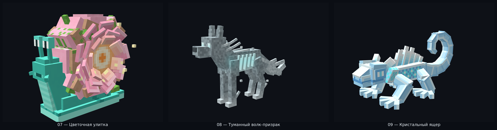
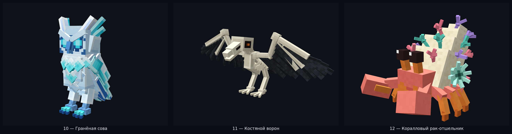
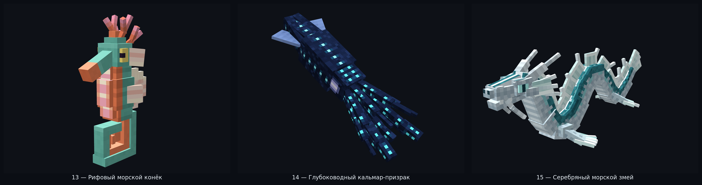

# Riftworld Fauna — Blockbench MCP 3D Models (Hytale / Articulated Style)

Серия детализированных шарнирных 3D-мобов для **Riftworld**, собранных и провалидированных через официальный **Blockbench MCP** (`blockbench-mcp-plugin`, формат `.bbmodel` v5.0 + Bedrock `.geo.json` / `.animation.json` + движковый `GeoModel` JSON + текстурные атласы `512×512` 32 px/block).

Вместо ступенчатых единичных вокселей модели построены в стиле **Hytale / Blockbench**: из крупных прямоугольных брусков, копланарных пластин, наклонных анатомических сегментов с чистыми шарнирами (`pivot` + Euler `ZYX`) и детализированной пиксель-арт росписью по граням.

---

## Выпуск 1 (Модели 01–03)

| № | ID | Название | Биом | Кости | Прямоугольные элементы | Blockbench (`.bbmodel`) | Bedrock Geo & Anim | Riftworld Geo & Texture | MCP Валидация |
| :-: | :--- | :--- | :--- | :-: | :-: | :--- | :--- | :--- | :-: |
| **01** | `porcelain_crane` | **Фарфоровый журавль** | `riftworld:elisar_city` | 9 | 71 | [`porcelain_crane.bbmodel`](./porcelain_crane.bbmodel) | [`geo`](./bedrock/porcelain_crane.geo.json) · [`anim`](./bedrock/porcelain_crane.animation.json) | [`geo`](../../mod/src/main/resources/assets/riftworld/geo/porcelain_crane.json) · [`png`](../../mod/src/main/resources/assets/riftworld/textures/entity/porcelain_crane.png) | `0 errors / 0 warnings` |
| **02** | `basalt_beetle` | **Базальтовый жук-углеед** | `riftworld:ashen_lands` | 13 | 99 | [`basalt_beetle.bbmodel`](./basalt_beetle.bbmodel) | [`geo`](./bedrock/basalt_beetle.geo.json) · [`anim`](./bedrock/basalt_beetle.animation.json) | [`geo`](../../mod/src/main/resources/assets/riftworld/geo/basalt_beetle.json) · [`png`](../../mod/src/main/resources/assets/riftworld/textures/entity/basalt_beetle.png) | `0 errors / 0 warnings` |
| **03** | `ash_moth` | **Пепельная моль** | `riftworld:ashen_lands` | 12 | 69 | [`ash_moth.bbmodel`](./ash_moth.bbmodel) | [`geo`](./bedrock/ash_moth.geo.json) · [`anim`](./bedrock/ash_moth.animation.json) | [`geo`](../../mod/src/main/resources/assets/riftworld/geo/ash_moth.json) · [`png`](../../mod/src/main/resources/assets/riftworld/textures/entity/ash_moth.png) | `0 errors / 0 warnings` |

Подробный отчёт Партии 1: **[`reports/blockbench_mcp/batch_01/README.md`](../../reports/blockbench_mcp/batch_01/README.md)**.

---

## Выпуск 2 (Модели 04–06)

| № | ID | Название | Биом | Кости | Прямоугольные элементы | Blockbench (`.bbmodel`) | Bedrock Geo & Anim | Riftworld Geo & Texture | MCP Валидация |
| :-: | :--- | :--- | :--- | :-: | :-: | :--- | :--- | :--- | :-: |
| **04** | `amethyst_fox` | **Аметистовый лис** | `riftworld:violet_hills` | 10 | 52 | [`amethyst_fox.bbmodel`](./amethyst_fox.bbmodel) | [`geo`](./bedrock/amethyst_fox.geo.json) · [`anim`](./bedrock/amethyst_fox.animation.json) | [`geo`](../../mod/src/main/resources/assets/riftworld/geo/amethyst_fox.json) · [`png`](../../mod/src/main/resources/assets/riftworld/textures/entity/amethyst_fox.png) | `0 errors / 0 warnings` |
| **05** | `sizo_leafwing` | **Сизый листокрыл** | `riftworld:sizo_grove` | 12 | 89 | [`sizo_leafwing.bbmodel`](./sizo_leafwing.bbmodel) | [`geo`](./bedrock/sizo_leafwing.geo.json) · [`anim`](./bedrock/sizo_leafwing.animation.json) | [`geo`](../../mod/src/main/resources/assets/riftworld/geo/sizo_leafwing.json) · [`png`](../../mod/src/main/resources/assets/riftworld/textures/entity/sizo_leafwing.png) | `0 errors / 0 warnings` |
| **06** | `azure_frog` | **Лазурный древесный лягуш** | `riftworld:waterfall_gardens` | 8 | 68 | [`azure_frog.bbmodel`](./azure_frog.bbmodel) | [`geo`](./bedrock/azure_frog.geo.json) · [`anim`](./bedrock/azure_frog.animation.json) | [`geo`](../../mod/src/main/resources/assets/riftworld/geo/azure_frog.json) · [`png`](../../mod/src/main/resources/assets/riftworld/textures/entity/azure_frog.png) | `0 errors / 0 warnings` |

Подробный отчёт Партии 2: **[`reports/blockbench_mcp/batch_02/README.md`](../../reports/blockbench_mcp/batch_02/README.md)**.

---

## Выпуск 3 (Модели 07–09)

| № | ID | Название | Биом | Кости | Прямоугольные элементы | Blockbench (`.bbmodel`) | Bedrock Geo & Anim | Riftworld Geo & Texture | MCP Валидация |
| :-: | :--- | :--- | :--- | :-: | :-: | :--- | :--- | :--- | :-: |
| **07** | `blossom_snail` | **Цветочная улитка** | `riftworld:waterfall_gardens` | 7 | 113 | [`blossom_snail.bbmodel`](./blossom_snail.bbmodel) | [`geo`](./bedrock/blossom_snail.geo.json) · [`anim`](./bedrock/blossom_snail.animation.json) | [`geo`](../../mod/src/main/resources/assets/riftworld/geo/blossom_snail.json) · [`png`](../../mod/src/main/resources/assets/riftworld/textures/entity/blossom_snail.png) | `0 errors / 0 warnings` |
| **08** | `phantom_wolf` | **Туманный волк-призрак** | `riftworld:mist_keep` | 9 | 70 | [`phantom_wolf.bbmodel`](./phantom_wolf.bbmodel) | [`geo`](./bedrock/phantom_wolf.geo.json) · [`anim`](./bedrock/phantom_wolf.animation.json) | [`geo`](../../mod/src/main/resources/assets/riftworld/geo/phantom_wolf.json) · [`png`](../../mod/src/main/resources/assets/riftworld/textures/entity/phantom_wolf.png) | `0 errors / 0 warnings` |
| **09** | `crystal_gecko` | **Кристальный ящер** | `riftworld:crystal_rifts` | 8 | 64 | [`crystal_gecko.bbmodel`](./crystal_gecko.bbmodel) | [`geo`](./bedrock/crystal_gecko.geo.json) · [`anim`](./bedrock/crystal_gecko.animation.json) | [`geo`](../../mod/src/main/resources/assets/riftworld/geo/crystal_gecko.json) · [`png`](../../mod/src/main/resources/assets/riftworld/textures/entity/crystal_gecko.png) | `0 errors / 0 warnings` |

Подробный отчёт Партии 3: **[`reports/blockbench_mcp/batch_03/README.md`](../../reports/blockbench_mcp/batch_03/README.md)**.

---

## Выпуск 4 (Модели 10–12)

| № | ID | Название | Биом | Кости | Прямоугольные элементы | Blockbench (`.bbmodel`) | Bedrock Geo & Anim | Riftworld Geo & Texture | MCP Валидация |
| :-: | :--- | :--- | :--- | :-: | :-: | :--- | :--- | :--- | :-: |
| **10** | `faceted_owl` | **Гранёная сова** | `riftworld:crystal_rifts` | 8 | 73 | [`faceted_owl.bbmodel`](./faceted_owl.bbmodel) | [`geo`](./bedrock/faceted_owl.geo.json) · [`anim`](./bedrock/faceted_owl.animation.json) | [`geo`](../../mod/src/main/resources/assets/riftworld/geo/faceted_owl.json) · [`png`](../../mod/src/main/resources/assets/riftworld/textures/entity/faceted_owl.png) | `0 errors / 0 warnings` |
| **11** | `bone_raven` | **Костяной ворон** | `riftworld:morok_hollow` | 9 | 87 | [`bone_raven.bbmodel`](./bone_raven.bbmodel) | [`geo`](./bedrock/bone_raven.geo.json) · [`anim`](./bedrock/bone_raven.animation.json) | [`geo`](../../mod/src/main/resources/assets/riftworld/geo/bone_raven.json) · [`png`](../../mod/src/main/resources/assets/riftworld/textures/entity/bone_raven.png) | `0 errors / 0 warnings` |
| **12** | `coral_hermit_crab` | **Коралловый рак-отшельник** | `riftworld:shallow_reef` | 13 | 94 | [`coral_hermit_crab.bbmodel`](./coral_hermit_crab.bbmodel) | [`geo`](./bedrock/coral_hermit_crab.geo.json) · [`anim`](./bedrock/coral_hermit_crab.animation.json) | [`geo`](../../mod/src/main/resources/assets/riftworld/geo/coral_hermit_crab.json) · [`png`](../../mod/src/main/resources/assets/riftworld/textures/entity/coral_hermit_crab.png) | `0 errors / 0 warnings` |

Подробный отчёт Партии 4: **[`reports/blockbench_mcp/batch_04/README.md`](../../reports/blockbench_mcp/batch_04/README.md)**.

---

## Выпуск 5 — Финал серии (Модели 13–15, 15/15 завершено)

| № | ID | Название | Биом | Кости | Прямоугольные элементы | Blockbench (`.bbmodel`) | Bedrock Geo & Anim | Riftworld Geo & Texture | MCP Валидация |
| :-: | :--- | :--- | :--- | :-: | :-: | :--- | :--- | :--- | :-: |
| **13** | `reef_seahorse` | **Рифовый морской конёк** | `riftworld:shallow_reef` | 9 | 43 | [`reef_seahorse.bbmodel`](./reef_seahorse.bbmodel) | [`geo`](./bedrock/reef_seahorse.geo.json) · [`anim`](./bedrock/reef_seahorse.animation.json) | [`geo`](../../mod/src/main/resources/assets/riftworld/geo/reef_seahorse.json) · [`png`](../../mod/src/main/resources/assets/riftworld/textures/entity/reef_seahorse.png) | `0 errors / 0 warnings` |
| **14** | `ghost_squid` | **Глубоководный кальмар-призрак** | `riftworld:abyss` | 8 | 41 | [`ghost_squid.bbmodel`](./ghost_squid.bbmodel) | [`geo`](./bedrock/ghost_squid.geo.json) · [`anim`](./bedrock/ghost_squid.animation.json) | [`geo`](../../mod/src/main/resources/assets/riftworld/geo/ghost_squid.json) · [`png`](../../mod/src/main/resources/assets/riftworld/textures/entity/ghost_squid.png) | `0 errors / 0 warnings` |
| **15** | `silver_sea_serpent` | **Серебряный морской змей** | `riftworld:maja_ocean` | 11 | 120 | [`silver_sea_serpent.bbmodel`](./silver_sea_serpent.bbmodel) | [`geo`](./bedrock/silver_sea_serpent.geo.json) · [`anim`](./bedrock/silver_sea_serpent.animation.json) | [`geo`](../../mod/src/main/resources/assets/riftworld/geo/silver_sea_serpent.json) · [`png`](../../mod/src/main/resources/assets/riftworld/textures/entity/silver_sea_serpent.png) | `0 errors / 0 warnings` |

Подробный отчёт Партии 5: **[`reports/blockbench_mcp/batch_05/README.md`](../../reports/blockbench_mcp/batch_05/README.md)**.

