# «Разлом» — концепты мобов для биомов

**15 ИИ-концептов для всех 11 биомов Элисара:** по одному или два новых существа на биом. Блочная стилистика Minecraft, белый фон, палитры под оформление существующего мода.

**Обновление по запросу:** для Рощи Сизо мшистый голем заменён **Сизым листокрылом** — живым древесным драконом. В итоговом комплекте нет варианта голема или робота для этого биома.

Это художественные концепты, **не скриншоты игры и не готовые игровые модели**. Описанные роли существ — идеи, а не реализованные механики.

**На этапе создания концептов существующие файлы мода не изменялись.** Все исходные иллюстрации находятся в `reports/biome_mob_concepts/`; спавн, баланс и версия мода не затронуты. Последующий этап — [модели и фотогалерея Blockbench](../blockbench_first_batch/photos/README.md) — опубликован отдельно.

[Общий лист всех 15 концептов](00_overview.png) · [Архив подборки](riftworld_biome_mob_concepts.zip)

## 01 — Фарфоровый журавль
**Биом:** `riftworld:elisar_city` · Город Элисара

Белая керамика, селадоновые крылья и золотые прожилки сочетаются с фарфоровой архитектурой города. Спокойная птица садов; постамент на иллюстрации — оформление концепта, не часть существа.

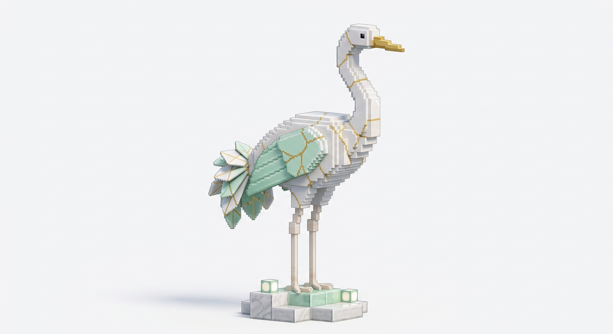

## 02 — Базальтовый жук-углеед
**Биом:** `riftworld:ashen_lands` · Пепельные земли

Тяжёлый панцирь из базальтовых плит, шесть коротких лап и оранжевые трещины между пластинами. Наземный обитатель вулканической пустоши, не копия Тлеющего стража.

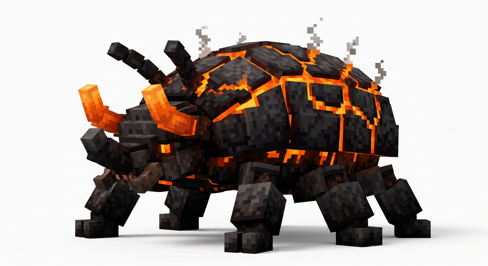

## 03 — Пепельная моль
**Биом:** `riftworld:ashen_lands` · Пепельные земли

Широкие серые крылья с глазками и горячими оранжевыми кончиками, перистые усики и облачко пепла. Летающий силуэт дополняет тяжёлого жука и перекликается с белым пеплом биома.

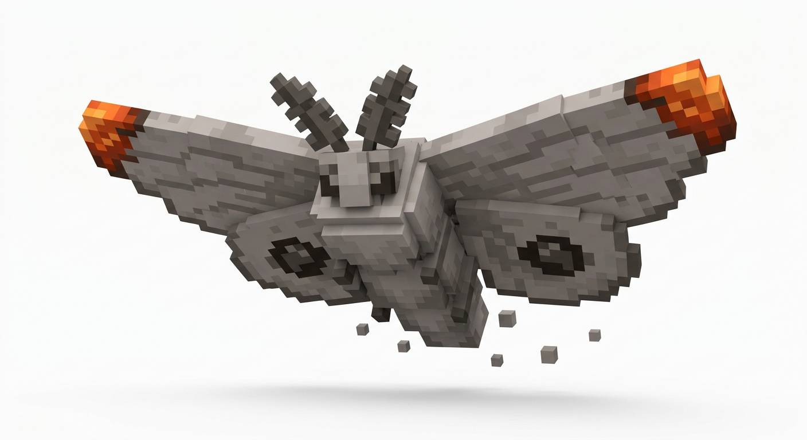

## 04 — Аметистовый лис
**Биом:** `riftworld:violet_hills` · Аметистовые холмы

Фиолетово-сиреневая шерсть, белая грудка и кристаллические наросты вдоль спины и на хвосте. Небольшой осторожный обитатель цветущих холмов.

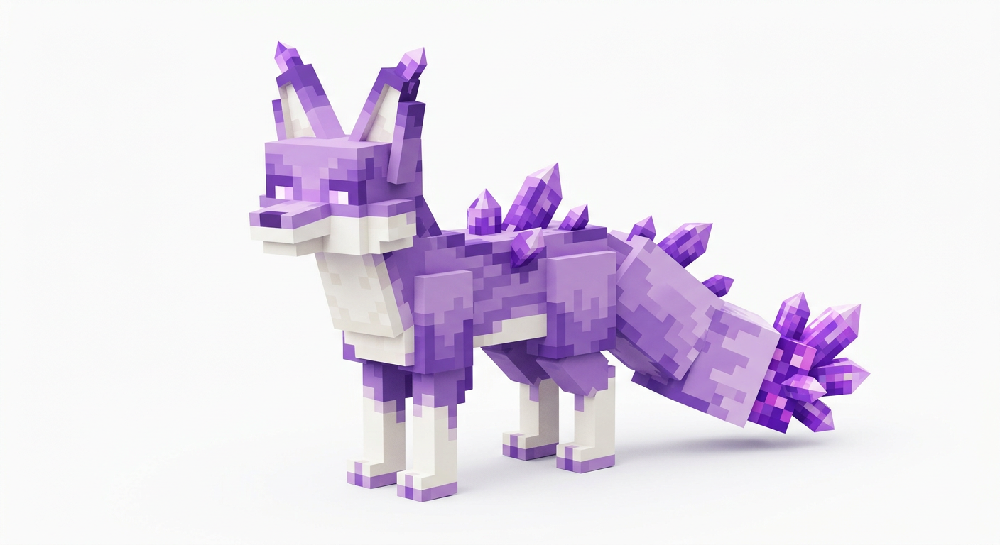

## 05 — Сизый листокрыл · новая версия
**Биом:** `riftworld:sizo_grove` · Роща Сизо

Небольшой живой древесный дракон вместо голема. Серебристо-мятная шерстка, белые крылья-листья с сизыми прожилками, ветвистые рожки, янтарные глаза и цепкий хвост с листовидной кисточкой. Васильковые цветочки связывают его с палитрой рощи.

Задуман как любопытный обитатель многоярусных крон: перепархивает между ветвями и планирует над лесными тропами. Никакого каменного тела, механических суставов или роботизированных деталей.

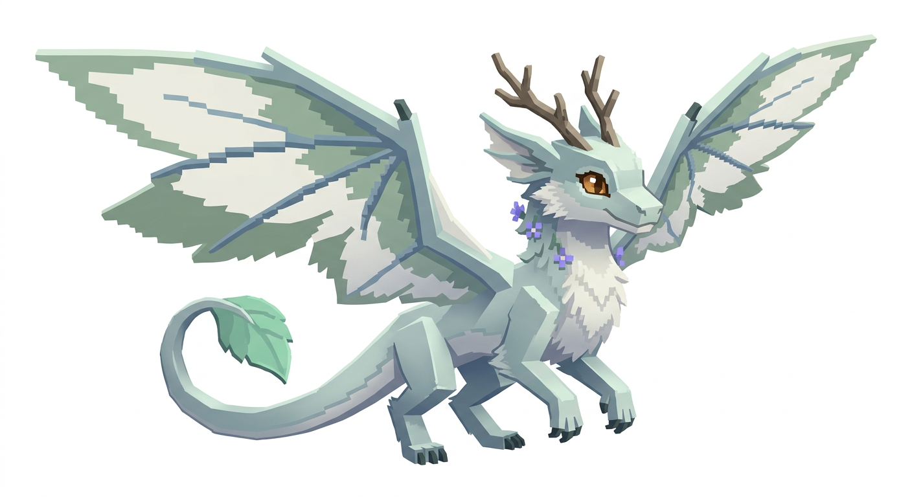

## 06 — Лазурный древесный лягуш
**Биом:** `riftworld:waterfall_gardens` · Висячие сады

Бирюзовое тело, золотистые глаза и воротник из розовых лепестков. Небольшой обитатель влажных садов; цветочные детали связывают его с растительностью биома. Блок земли на картинке — подставка для презентации.

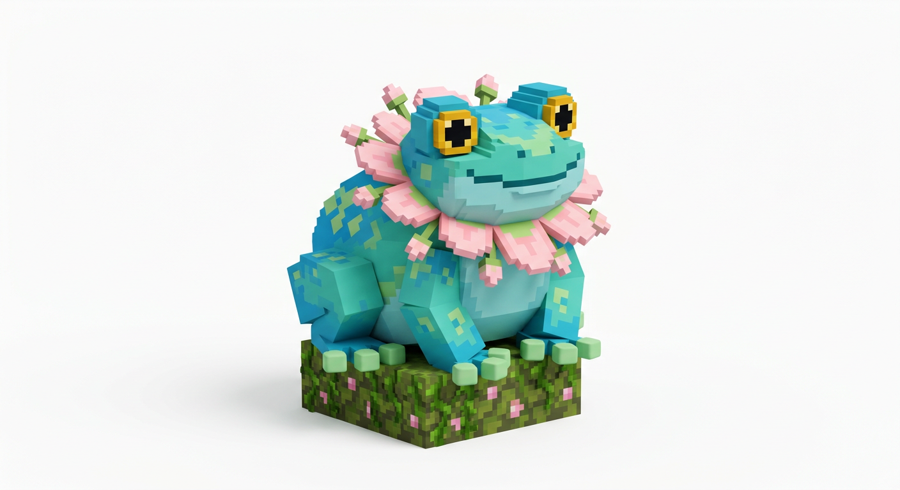

## 07 — Цветочная улитка
**Биом:** `riftworld:waterfall_gardens` · Висячие сады

Мятное тело и раковина-цветок с тёплой светящейся сердцевиной. Медлительный садовый обитатель, задуманный как спокойный контраст летающей фауне Элисара. Зелёная подставка не считается частью модели.

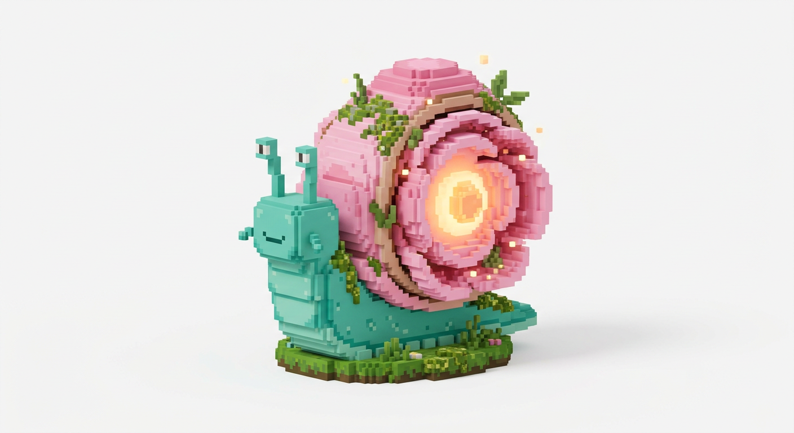

## 08 — Туманный волк-призрак
**Биом:** `riftworld:mist_keep` · Туманная крепость

Серый полупрозрачный силуэт, холодные голубые глаза, различимые рёбра и расплетающийся на кубики туман. Призрачный обитатель крепости; светящиеся глаза продолжают приём, уже используемый у Морока.

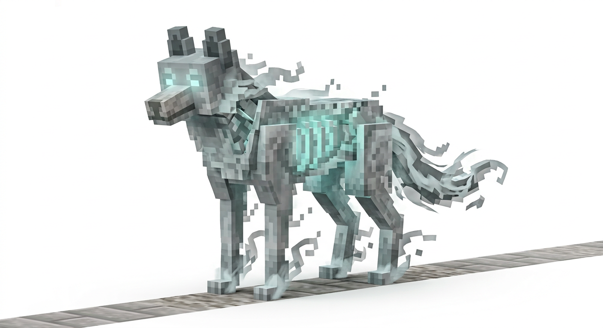

## 09 — Кристальный ящер
**Биом:** `riftworld:crystal_rifts` · Хрустальные разломы

Ледяные голубые грани, гранёная чешуя, гребень и закрученный хвост. Небольшое существо кристальных островов, отличное по силуэту от высоких Гранёных Прислужников.

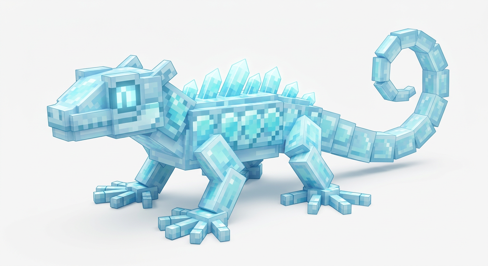

## 10 — Гранёная сова
**Биом:** `riftworld:crystal_rifts` · Хрустальные разломы

Слоистые кристаллы вместо перьев, светящиеся бирюзовые глаза и острые ушки. Летающий наблюдатель Разломов; кристаллическая опора показана только для презентационной позы.

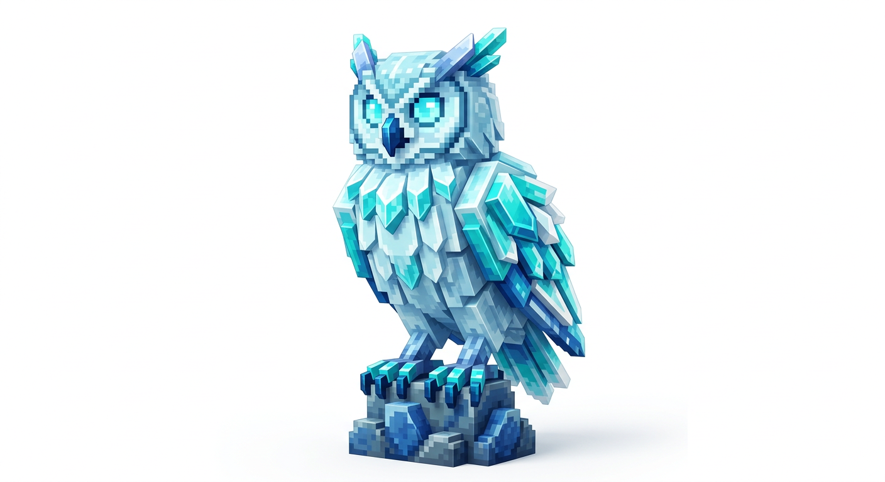

## 11 — Костяной ворон
**Биом:** `riftworld:morok_hollow` · Мороковая Падь

Костяной череп с угольками в глазницах, открытая рёбристая грудная клетка и рваные чёрные перья на угловатых крыльях. Небольшой хоррор-силуэт рядом с уже существующими Мороком и Вендиго, без повторения их гуманоидной формы. Палитра: старая кость, угольный серый, приглушённый оранжевый.

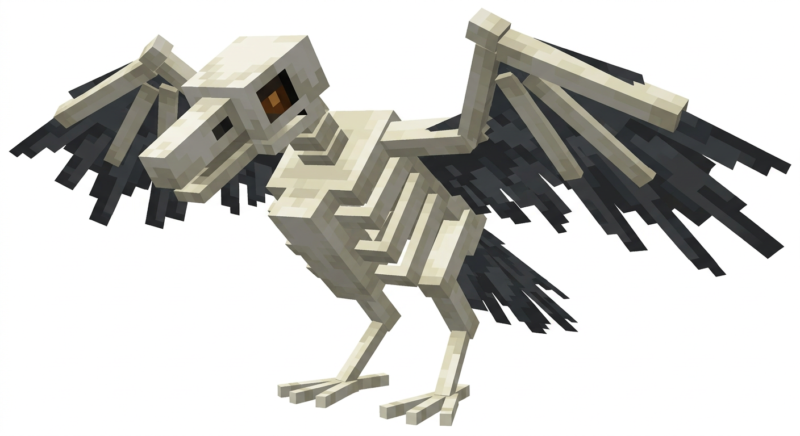

## 12 — Коралловый рак-отшельник
**Биом:** `riftworld:shallow_reef` · Мелководный риф

Кораллово-розовый рак с разными клешнями и светлой раковиной, заросшей ветвистыми кораллами и небольшой актинией. Мирный собиратель рифа. Палитра: коралловый розовый, оранжевый, морская зелень, кремовый и немного лавандового.

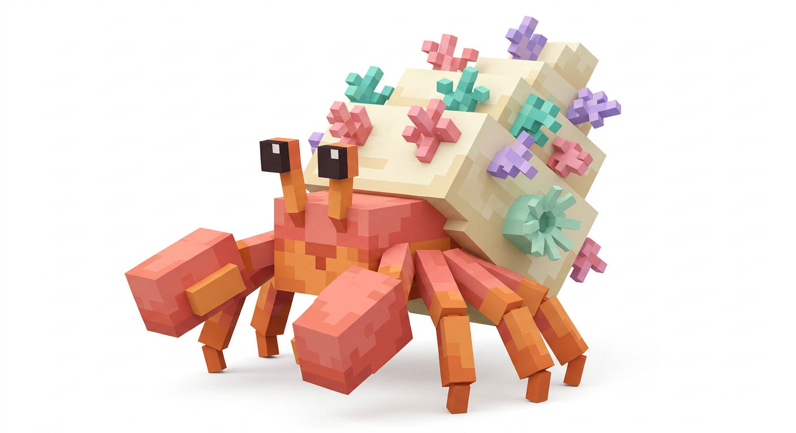

## 13 — Рифовый морской конёк
**Биом:** `riftworld:shallow_reef` · Мелководный риф

Вертикальное сегментированное тело, закрученный хвост, трубчатая мордочка и коралловый гребешок. Спокойная фауна мелководья в бирюзово-коралловой гамме, рядом с уже существующими рыбами Элисара.

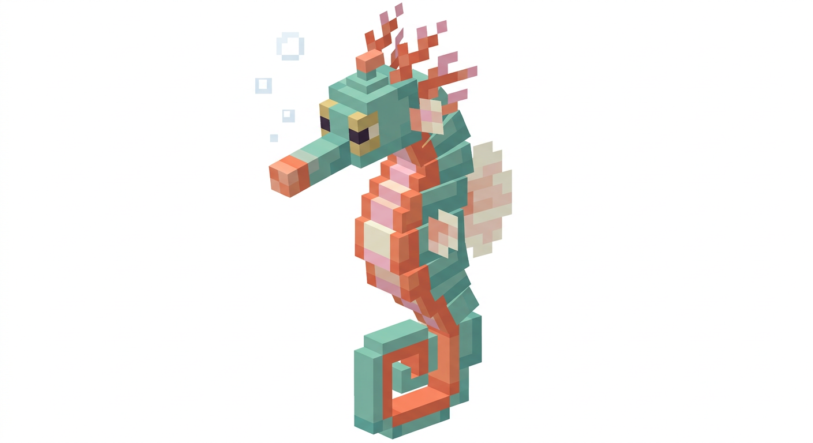

## 14 — Глубоководный кальмар-призрак
**Биом:** `riftworld:abyss` · Бездна

Вытянутая тёмно-синяя мантия, длинные ступенчатые щупальца и ряды бирютовых биолюминесцентных точек. Таинственный обитатель глубины, задуманный отдельно от уже имеющихся рыб, угря и Лиоплевродона. Светлые контуры позволяют рассмотреть силуэт на белом фоне.

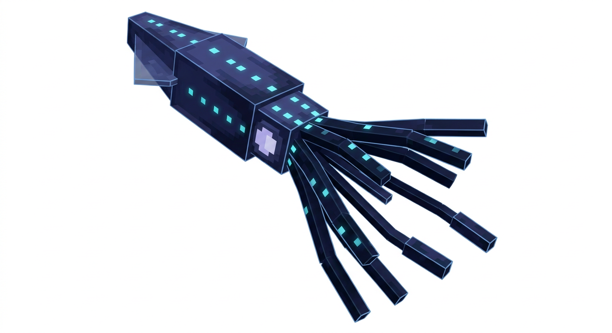

## 15 — Серебряный морской змей
**Биом:** `riftworld:maja_ocean` · Океан Махи

Длинное серебристо-голубое тело, полупрозрачный плавниковый гребень, небольшие боковые плавники и усики. Редкий странник океана, **не босс и не замена Эль Гран Махи**: заметно меньший масштаб и спокойный силуэт.

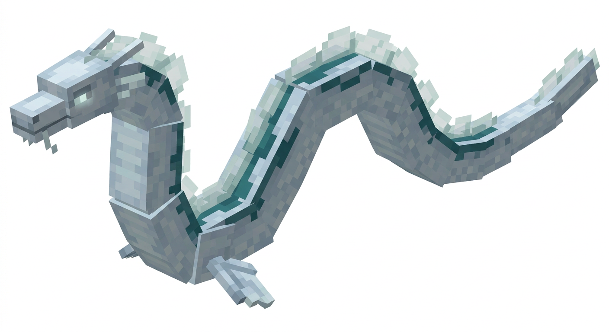

## Покрытие биомов

| Биом | Концепты | Номера |
|---|---|---:|
| Город Элисара — `elisar_city` | Фарфоровый журавль | 01 |
| Пепельные земли — `ashen_lands` | Базальтовый жук-углеед, Пепельная моль | 02–03 |
| Аметистовые холмы — `violet_hills` | Аметистовый лис | 04 |
| Роща Сизо — `sizo_grove` | Сизый листокрыл | 05 |
| Висячие сады — `waterfall_gardens` | Лазурный древесный лягуш, Цветочная улитка | 06–07 |
| Туманная крепость — `mist_keep` | Туманный волк-призрак | 08 |
| Хрустальные разломы — `crystal_rifts` | Кристальный ящер, Гранёная сова | 09–10 |
| Мороковая Падь — `morok_hollow` | Костяной ворон | 11 |
| Мелководный риф — `shallow_reef` | Коралловый рак-отшельник, Рифовый морской конёк | 12–13 |
| Бездна — `abyss` | Глубоководный кальмар-призрак | 14 |
| Океан Махи — `maja_ocean` | Серебряный морской змей | 15 |

## Состав комплекта

- `01_…png`—`15_…png`: 15 отдельных исходных изображений.
- `05_sizo_grove_sizo_leafwing.png`: новая версия для Рощи Сизо, без голема.
- `00_overview.png`: общий лист всех 15 концептов с названиями и биомами.
- `riftworld_biome_mob_concepts.zip`: полный комплект с отдельными PNG, общим листом и этим описанием.
