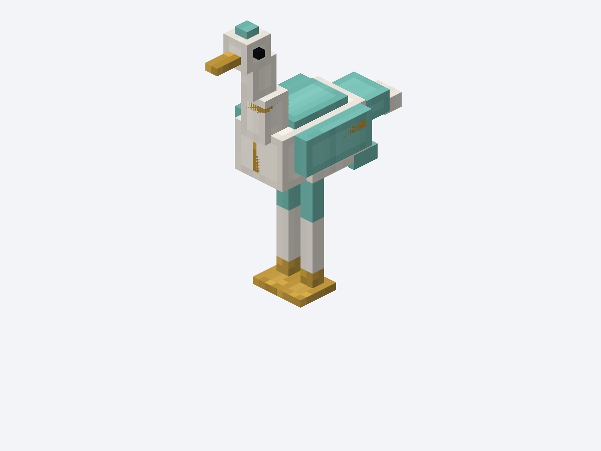
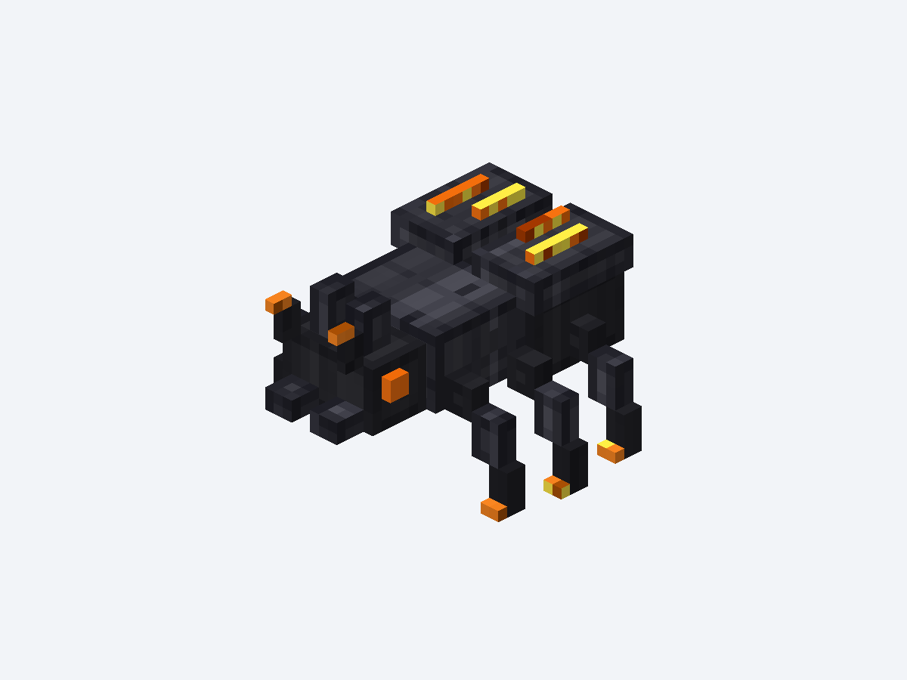
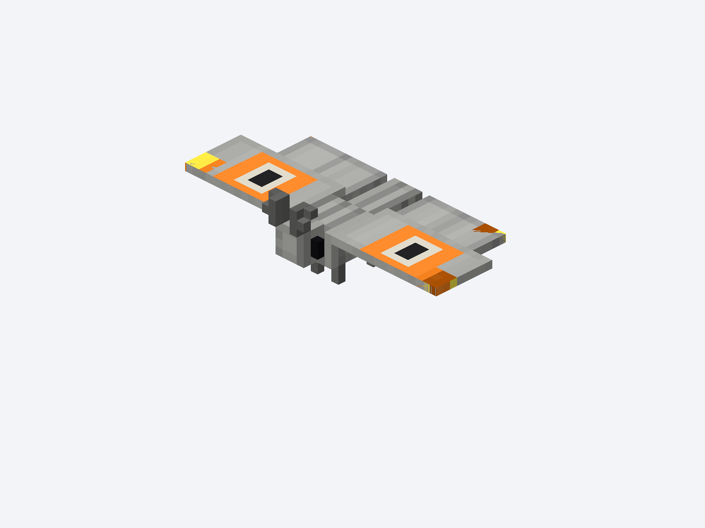
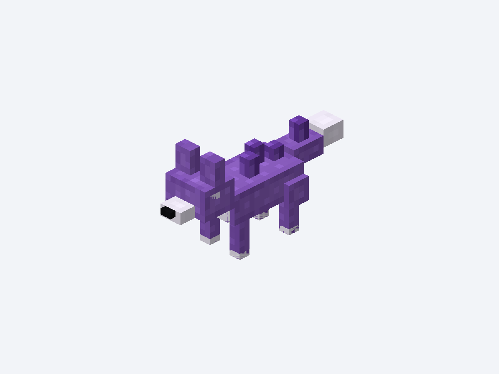

# Фотографии первых четырёх моделей Riftworld

Снимки загруженных `.bbmodel`-проектов, сделанные через Blockbench 5.2.2
`Screencam.advancedScreenshot`. Разрешение отдельных фотографий — 1200 × 900.
Это виды редактора Blockbench, **не скриншоты Minecraft**.

[Все четыре модели на одном изображении](00_all_models.png) ·
[Описание моделей и проверки](../README.md) ·
[Инструменты Blockbench API](../../../tools/blockbench/README.md)

| Модель | Фотография | Редактируемый проект | Текстура |
|---|---|---|---|
| Фарфоровый журавль | [PNG, 1200 × 900](01_porcelain_crane.png) | [`.bbmodel`](../../../blockbench/riftworld_fauna/porcelain_crane.bbmodel) | [PNG, 256 × 256](../../../mod/src/main/resources/assets/riftworld/textures/entity/porcelain_crane.png) |
| Базальтовый жук-углеед | [PNG, 1200 × 900](02_basalt_beetle.png) | [`.bbmodel`](../../../blockbench/riftworld_fauna/basalt_beetle.bbmodel) | [PNG, 256 × 256](../../../mod/src/main/resources/assets/riftworld/textures/entity/basalt_beetle.png) |
| Пепельная моль | [PNG, 1200 × 900](03_ash_moth.png) | [`.bbmodel`](../../../blockbench/riftworld_fauna/ash_moth.bbmodel) | [PNG, 256 × 256](../../../mod/src/main/resources/assets/riftworld/textures/entity/ash_moth.png) |
| Аметистовый лис | [PNG, 1200 × 900](04_amethyst_fox.png) | [`.bbmodel`](../../../blockbench/riftworld_fauna/amethyst_fox.bbmodel) | [PNG, 256 × 256](../../../mod/src/main/resources/assets/riftworld/textures/entity/amethyst_fox.png) |

## Фарфоровый журавль

## Базальтовый жук-углеед

## Пепельная моль

## Аметистовый лис

## Статус

Опубликованы модели, текстуры, исходные Blockbench-проекты и генератор.
Новые Java-сущности и регистрации пока не добавлены: эти четыре существа ещё не
появляются в игре. Естественный спавн и баланс существующих мобов не изменены.
