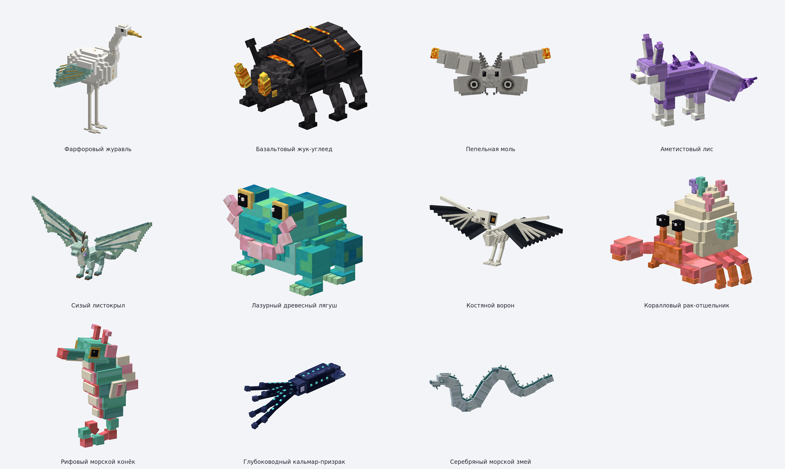

# Фотографии одиннадцати моделей Riftworld

Снимки `.bbmodel` сделаны через Blockbench 5.2.2 `Screencam.advancedScreenshot`,
1600 × 1200. Это виды редактора, **не скриншоты Minecraft**. Последнее обновление:
переработаны листокрыл и ворон, добавлен серебряный морской змей. Модели приближены к концептам, но не повторяют их буквально.

[Все одиннадцать моделей](00_all_models.png) · [Последние пять: концепт / модель](11_latest_reference_comparison.png) ·
[Новые три: концепт / модель](12_three_reference_comparison.png) · [Первые шесть: концепт / модель](05_reference_comparison.png) · [Описание и проверки](../README.md)

| Модель | Фото | Дополнительные ракурсы | Редактируемый проект |
|---|---|---|---|
| Фарфоровый журавль | [PNG](01_porcelain_crane.png) | [Спереди](06_crane_front.png) · [Сбоку](07_crane_side.png) | [`.bbmodel`](../../../blockbench/riftworld_fauna/porcelain_crane.bbmodel) |
| Базальтовый жук-углеед | [PNG](02_basalt_beetle.png) | [Спереди](08_beetle_front.png) · [Сбоку](09_beetle_side.png) | [`.bbmodel`](../../../blockbench/riftworld_fauna/basalt_beetle.bbmodel) |
| Пепельная моль | [PNG](03_ash_moth.png) | [Спереди](ash_moth_front.png) · [Сбоку](ash_moth_side.png) | [`.bbmodel`](../../../blockbench/riftworld_fauna/ash_moth.bbmodel) |
| Аметистовый лис | [PNG](04_amethyst_fox.png) | [Спереди](amethyst_fox_front.png) · [Сбоку](amethyst_fox_side.png) | [`.bbmodel`](../../../blockbench/riftworld_fauna/amethyst_fox.bbmodel) |
| Сизый листокрыл | [PNG](05_sizo_leafwing.png) | [Спереди](sizo_leafwing_front.png) · [Сбоку](sizo_leafwing_side.png) | [`.bbmodel`](../../../blockbench/riftworld_fauna/sizo_leafwing.bbmodel) |
| Лазурный древесный лягуш | [PNG](06_azure_frog.png) | [Спереди](azure_frog_front.png) · [Сбоку](azure_frog_side.png) | [`.bbmodel`](../../../blockbench/riftworld_fauna/azure_frog.bbmodel) |
| Костяной ворон | [PNG](07_bone_raven.png) | [Спереди](bone_raven_front.png) · [Сбоку](bone_raven_side.png) | [`.bbmodel`](../../../blockbench/riftworld_fauna/bone_raven.bbmodel) |
| Коралловый рак-отшельник | [PNG](08_coral_hermit_crab.png) | [Спереди](coral_hermit_crab_front.png) · [Сбоку](coral_hermit_crab_side.png) | [`.bbmodel`](../../../blockbench/riftworld_fauna/coral_hermit_crab.bbmodel) |
| Рифовый морской конёк | [PNG](09_reef_seahorse.png) | [Спереди](reef_seahorse_front.png) · [Сбоку](reef_seahorse_side.png) | [`.bbmodel`](../../../blockbench/riftworld_fauna/reef_seahorse.bbmodel) |
| Глубоководный кальмар-призрак | [PNG](10_ghost_squid.png) | [Спереди](ghost_squid_front.png) · [Сбоку](ghost_squid_side.png) | [`.bbmodel`](../../../blockbench/riftworld_fauna/ghost_squid.bbmodel) |
| Серебряный морской змей | [PNG](11_silver_sea_serpent.png) | [Спереди](silver_sea_serpent_front.png) · [Сбоку](silver_sea_serpent_side.png) | [`.bbmodel`](../../../blockbench/riftworld_fauna/silver_sea_serpent.bbmodel) |

## Общий вид

## Статус

Опубликованы модели, текстуры, исходные Blockbench-проекты и генератор. Сущности пока не
зарегистрированы в Minecraft; игровые анимации и внешний вид в игре не проверены. Яркие точки
кальмара не являются подтверждённым эффектом свечения. Java-код, естественный спавн и баланс
существующих мобов не изменялись.
