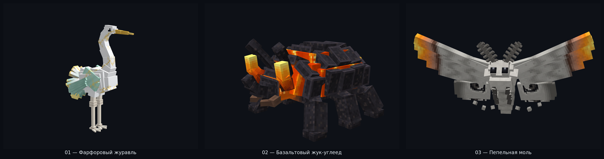
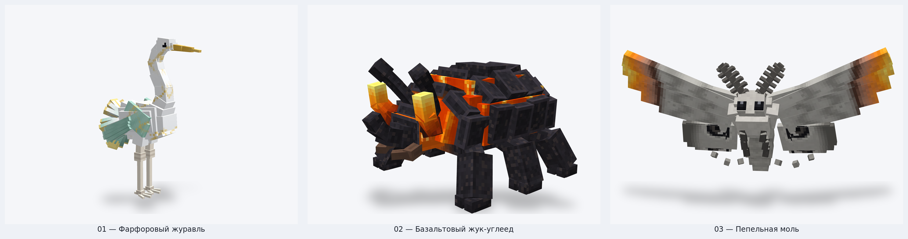
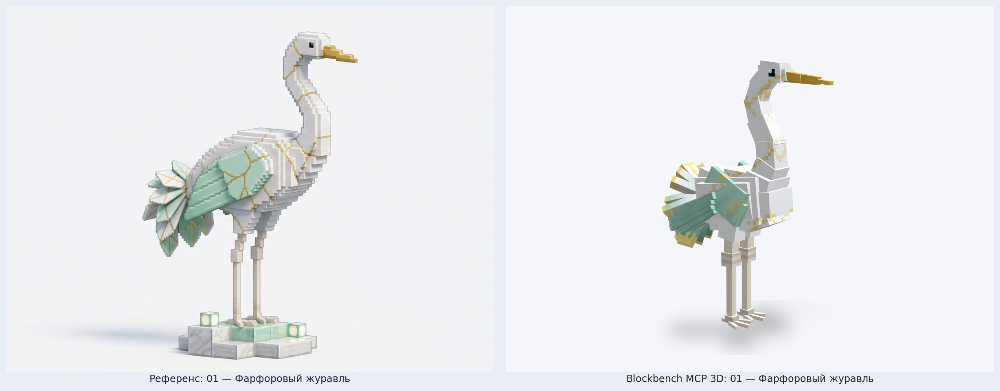
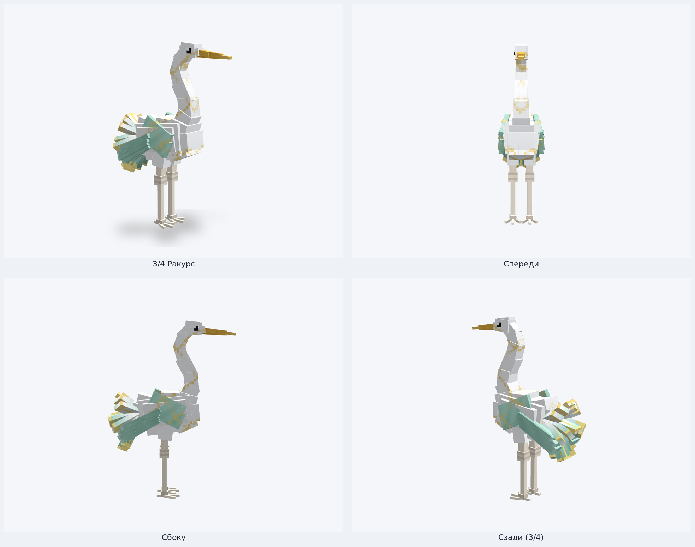
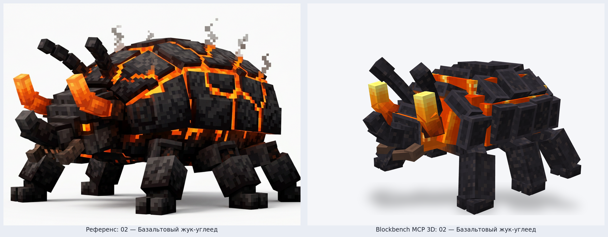
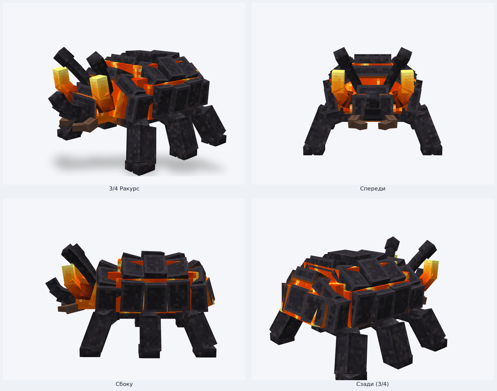
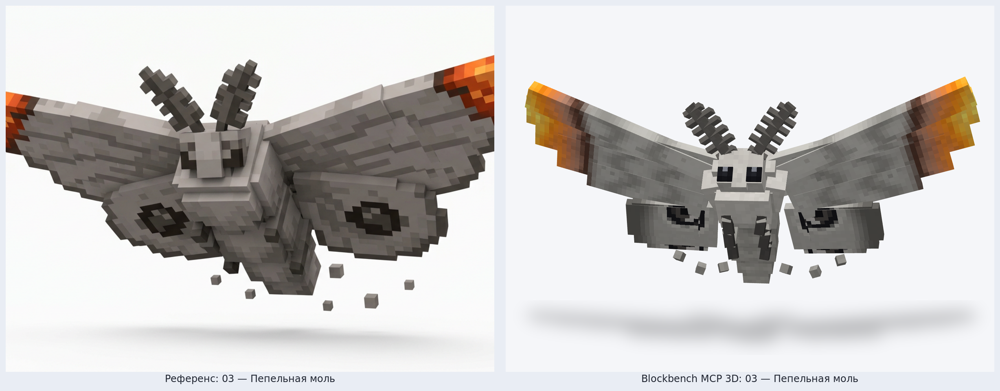
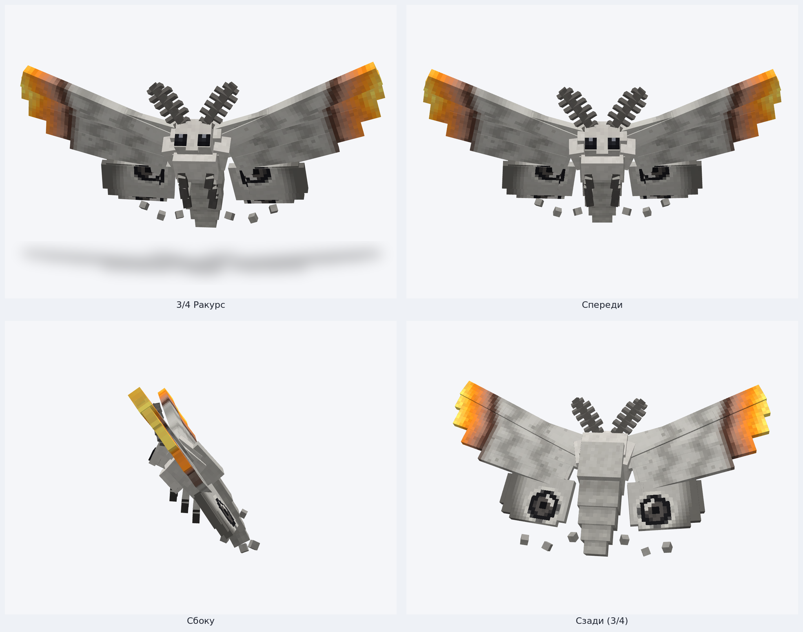

# Партия 1 (Модели 01–03) — Blockbench MCP 3D Рендеры и Сравнение с Референсами

Все 3 модели построены через официальный сервер **Blockbench MCP** (`bbmodel_create_project` → `bbmodel_edit_batch` → `bbmodel_set_textures` → `bbmodel_set_animations` → `bbmodel_validate` → `bbmodel_validate_animations` → `bbmodel_export_bedrock`) и отрендерены в **Blockbench 5.2.2** (`Screencam.advancedScreenshot`, MSAA, `NearestFilter`).

- Геометрия выполнена в стиле **Hytale / Blockbench** — из шарнирных прямоугольных элементов, вытянутых сегментов конечностей, наклонных бронеплит и широких копланарных пластин крыльев (без воксельной «лесенки» из единичных кубиков).
- Все 3 проекта прошли строгую геометрическую и анимационную проверку MCP (`bounds`, `floating`, `interpenetration`, `degenerate`, `uv_overlap`, `uv_scale`, `mirror` с `self_test: true`) с результатом **`0 errors, 0 warnings`**.

---

## Общая витрина (Модели 01–03)

### Тёмная студия

### Светлая студия

---

## 01 — Фарфоровый журавль (`porcelain_crane`)

- **Биом:** Элисар (`riftworld:elisar_city`)
- **Состав:** 9 костей, 71 прямоугольный элемент, текстурный атлас `512×512` (32 px/блок), цикл анимации `idle` (4.0 с)
- **Файлы:**
  - Blockbench проект: [`blockbench/riftworld_fauna/porcelain_crane.bbmodel`](../../../blockbench/riftworld_fauna/porcelain_crane.bbmodel)
  - Bedrock геометрия и анимация: [`porcelain_crane.geo.json`](../../../blockbench/riftworld_fauna/bedrock/porcelain_crane.geo.json) · [`porcelain_crane.animation.json`](../../../blockbench/riftworld_fauna/bedrock/porcelain_crane.animation.json)
  - Игровой GeoModel и текстура: [`geo/porcelain_crane.json`](../../../mod/src/main/resources/assets/riftworld/geo/porcelain_crane.json) · [`textures/entity/porcelain_crane.png`](../../../mod/src/main/resources/assets/riftworld/textures/entity/porcelain_crane.png)

### Сравнение с концепт-артом

### Обзор с 4 ракурсов (Blockbench 5.2.2)

---

## 02 — Базальтовый жук-углеед (`basalt_beetle`)

- **Биом:** Пепельные земли (`riftworld:ashen_lands`)
- **Состав:** 13 костей, 99 прямоугольных элементов, текстурный атлас `512×512` (32 px/блок), цикл анимации `idle` (4.0 с)
- **Файлы:**
  - Blockbench проект: [`blockbench/riftworld_fauna/basalt_beetle.bbmodel`](../../../blockbench/riftworld_fauna/basalt_beetle.bbmodel)
  - Bedrock геометрия и анимация: [`basalt_beetle.geo.json`](../../../blockbench/riftworld_fauna/bedrock/basalt_beetle.geo.json) · [`basalt_beetle.animation.json`](../../../blockbench/riftworld_fauna/bedrock/basalt_beetle.animation.json)
  - Игровой GeoModel и текстура: [`geo/basalt_beetle.json`](../../../mod/src/main/resources/assets/riftworld/geo/basalt_beetle.json) · [`textures/entity/basalt_beetle.png`](../../../mod/src/main/resources/assets/riftworld/textures/entity/basalt_beetle.png)

### Сравнение с концепт-артом

### Обзор с 4 ракурсов (Blockbench 5.2.2)

---

## 03 — Пепельная моль (`ash_moth`)

- **Биом:** Пепельные земли (`riftworld:ashen_lands`)
- **Состав:** 12 костей, 69 прямоугольных элементов, текстурный атлас `512×512` (32 px/блок), цикл анимации `idle` (2.4 с)
- **Файлы:**
  - Blockbench проект: [`blockbench/riftworld_fauna/ash_moth.bbmodel`](../../../blockbench/riftworld_fauna/ash_moth.bbmodel)
  - Bedrock геометрия и анимация: [`ash_moth.geo.json`](../../../blockbench/riftworld_fauna/bedrock/ash_moth.geo.json) · [`ash_moth.animation.json`](../../../blockbench/riftworld_fauna/bedrock/ash_moth.animation.json)
  - Игровой GeoModel и текстура: [`geo/ash_moth.json`](../../../mod/src/main/resources/assets/riftworld/geo/ash_moth.json) · [`textures/entity/ash_moth.png`](../../../mod/src/main/resources/assets/riftworld/textures/entity/ash_moth.png)

### Сравнение с концепт-артом

### Обзор с 4 ракурсов (Blockbench 5.2.2)

