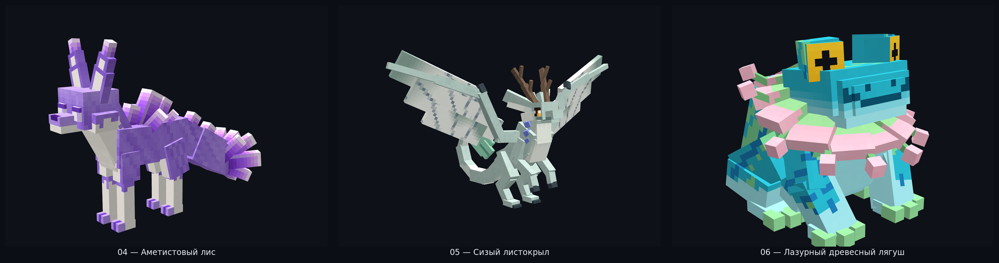
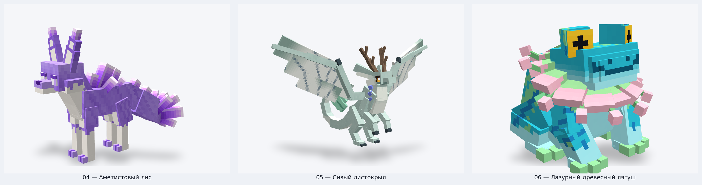
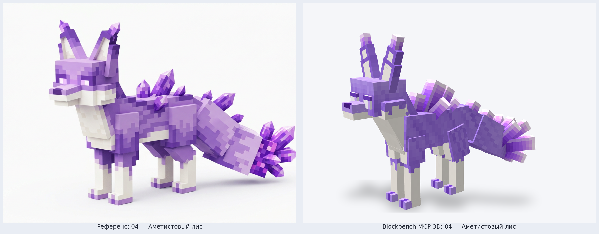
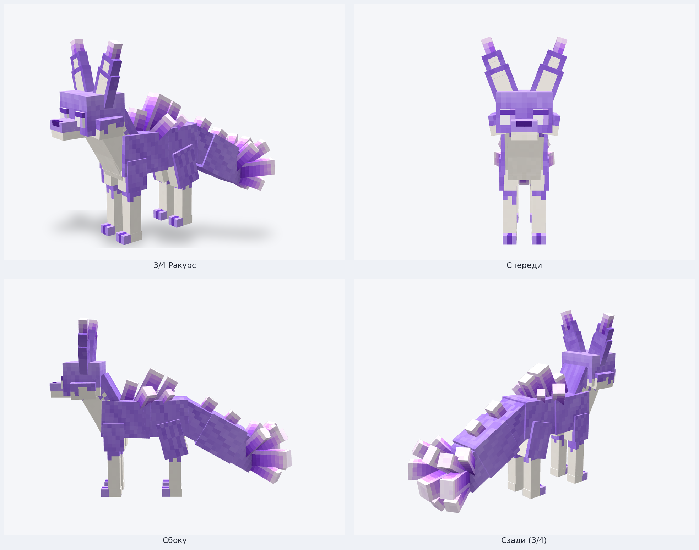
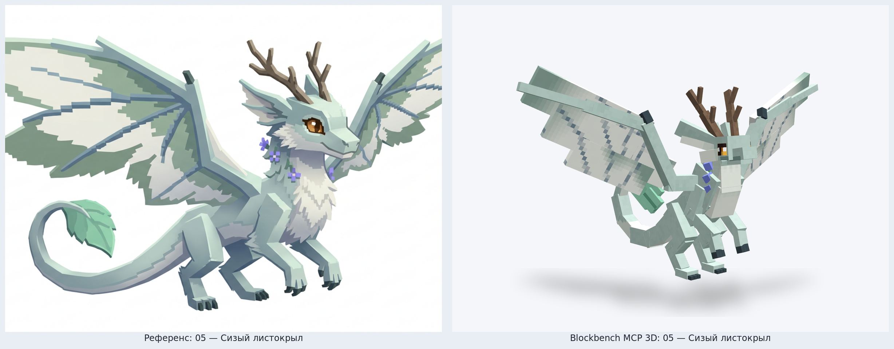
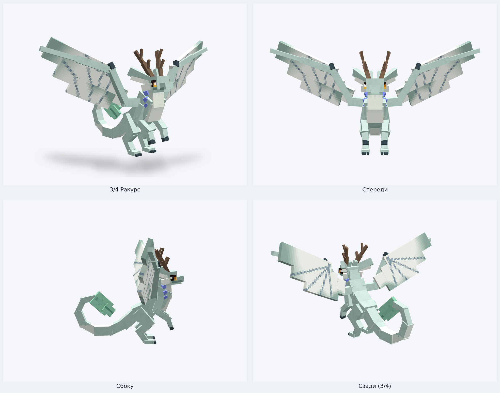
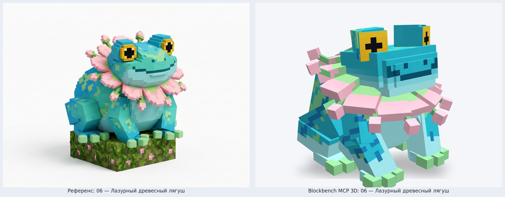
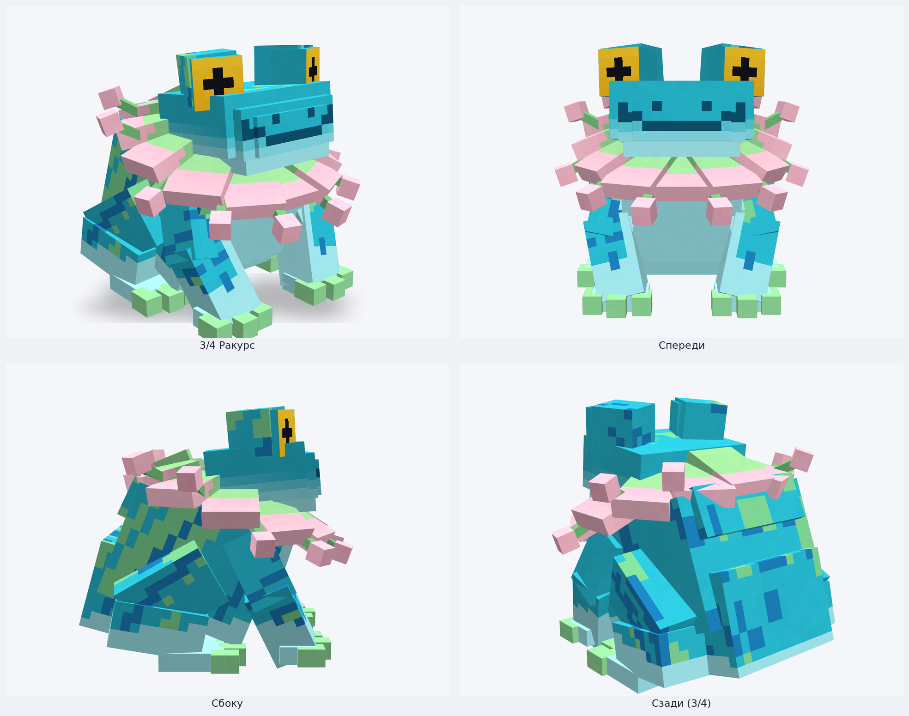

# Партия 2 (Модели 04–06) — Blockbench MCP 3D Рендеры и Сравнение с Референсами

Все 3 модели второй партии построены через официальный сервер **Blockbench MCP** (`bbmodel_create_project` → `bbmodel_edit_batch` → `bbmodel_set_textures` → `bbmodel_set_animations` → `bbmodel_validate` → `bbmodel_validate_animations` → `bbmodel_export_bedrock`) и отрендерены в **Blockbench 5.2.2** (`Screencam.advancedScreenshot`, MSAA, `NearestFilter`).

- Геометрия выполнена в шарнирном стиле **Hytale / Blockbench** — из прямоугольных брусков, наклонных сегментов конечностей, гранёных кристаллов, копланарных листовых пластин крыльев и лепестковых воротников (без воксельной «лесенки» из единичных кубиков).
- Все 3 проекта прошли строгую геометрическую и анимационную проверку MCP (`bounds`, `floating`, `interpenetration`, `degenerate`, `uv_overlap`, `uv_scale`, `mirror` с `self_test: true`) с результатом **`0 errors, 0 warnings`**.

---

## Общая витрина (Модели 04–06)

### Тёмная студия

### Светлая студия

---

## 04 — Аметистовый лис (`amethyst_fox`)

- **Биом:** Аметистовые холмы (`riftworld:violet_hills`)
- **Состав:** 10 костей, 52 прямоугольных элемента, текстурный атлас `512×512` (32 px/блок), цикл анимации `idle` (3.6 с)
- **Файлы:**
  - Blockbench проект: [`blockbench/riftworld_fauna/amethyst_fox.bbmodel`](../../../blockbench/riftworld_fauna/amethyst_fox.bbmodel)
  - Bedrock геометрия и анимация: [`amethyst_fox.geo.json`](../../../blockbench/riftworld_fauna/bedrock/amethyst_fox.geo.json) · [`amethyst_fox.animation.json`](../../../blockbench/riftworld_fauna/bedrock/amethyst_fox.animation.json)
  - Игровой GeoModel и текстура: [`geo/amethyst_fox.json`](../../../mod/src/main/resources/assets/riftworld/geo/amethyst_fox.json) · [`textures/entity/amethyst_fox.png`](../../../mod/src/main/resources/assets/riftworld/textures/entity/amethyst_fox.png)

### Сравнение с концепт-артом

### Обзор с 4 ракурсов (Blockbench 5.2.2)

---

## 05 — Сизый листокрыл (`sizo_leafwing`)

- **Биом:** Роща Сизо (`riftworld:sizo_grove`)
- **Состав:** 12 костей, 89 прямоугольных элементов, текстурный атлас `512×512` (32 px/блок), цикл анимации `idle` (3.6 с)
- **Файлы:**
  - Blockbench проект: [`blockbench/riftworld_fauna/sizo_leafwing.bbmodel`](../../../blockbench/riftworld_fauna/sizo_leafwing.bbmodel)
  - Bedrock геометрия и анимация: [`sizo_leafwing.geo.json`](../../../blockbench/riftworld_fauna/bedrock/sizo_leafwing.geo.json) · [`sizo_leafwing.animation.json`](../../../blockbench/riftworld_fauna/bedrock/sizo_leafwing.animation.json)
  - Игровой GeoModel и текстура: [`geo/sizo_leafwing.json`](../../../mod/src/main/resources/assets/riftworld/geo/sizo_leafwing.json) · [`textures/entity/sizo_leafwing.png`](../../../mod/src/main/resources/assets/riftworld/textures/entity/sizo_leafwing.png)

### Сравнение с концепт-артом

### Обзор с 4 ракурсов (Blockbench 5.2.2)

---

## 06 — Лазурный древесный лягуш (`azure_frog`)

- **Биом:** Висячие сады (`riftworld:waterfall_gardens`)
- **Состав:** 8 костей, 68 прямоугольных элементов, текстурный атлас `512×512` (32 px/блок), цикл анимации `idle` (3.2 с)
- **Файлы:**
  - Blockbench проект: [`blockbench/riftworld_fauna/azure_frog.bbmodel`](../../../blockbench/riftworld_fauna/azure_frog.bbmodel)
  - Bedrock геометрия и анимация: [`azure_frog.geo.json`](../../../blockbench/riftworld_fauna/bedrock/azure_frog.geo.json) · [`azure_frog.animation.json`](../../../blockbench/riftworld_fauna/bedrock/azure_frog.animation.json)
  - Игровой GeoModel и текстура: [`geo/azure_frog.json`](../../../mod/src/main/resources/assets/riftworld/geo/azure_frog.json) · [`textures/entity/azure_frog.png`](../../../mod/src/main/resources/assets/riftworld/textures/entity/azure_frog.png)

### Сравнение с концепт-артом

### Обзор с 4 ракурсов (Blockbench 5.2.2)

