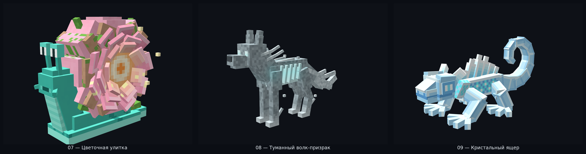
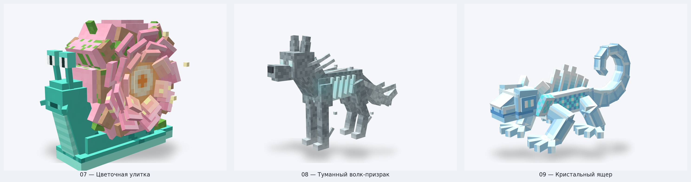
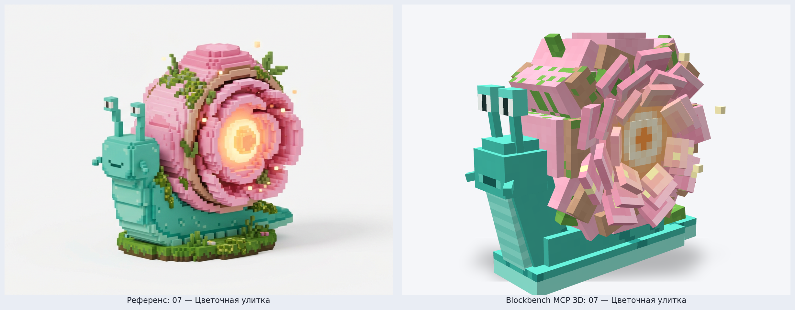
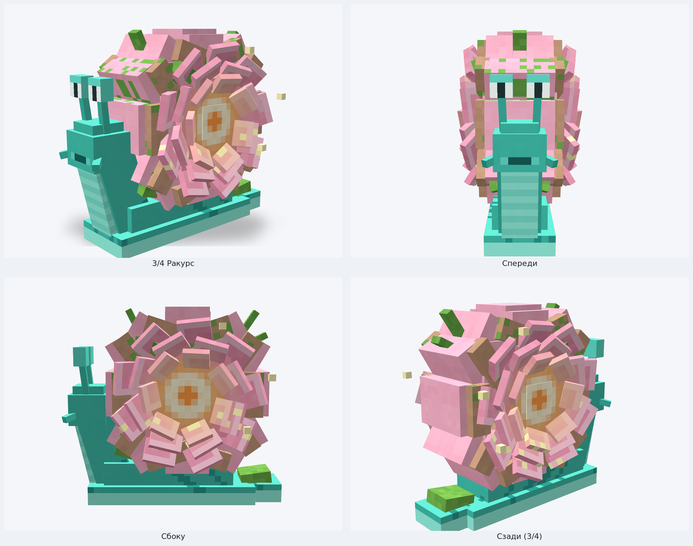
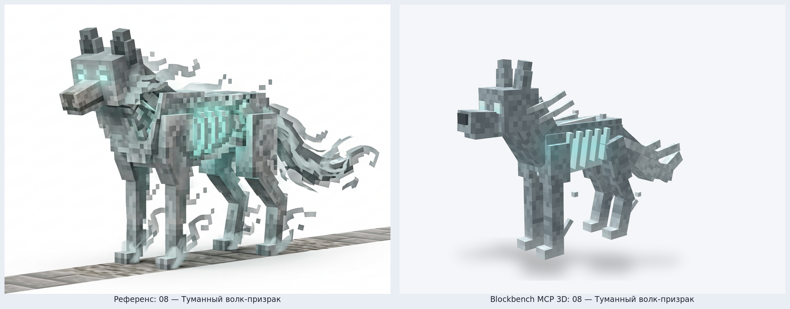
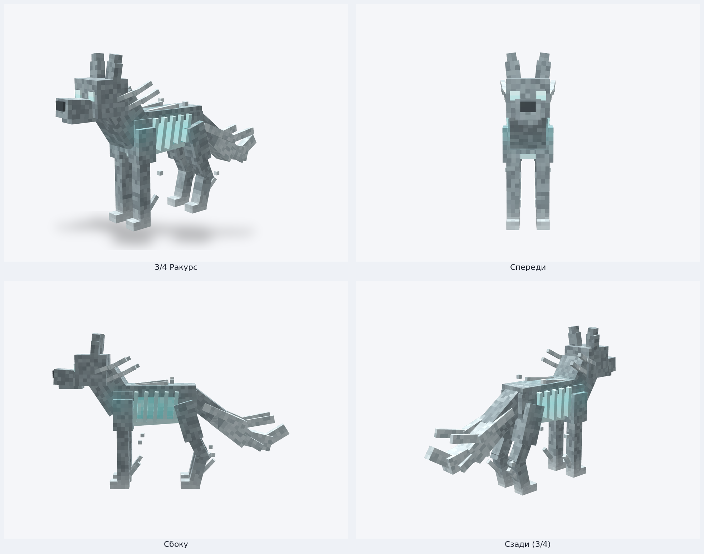
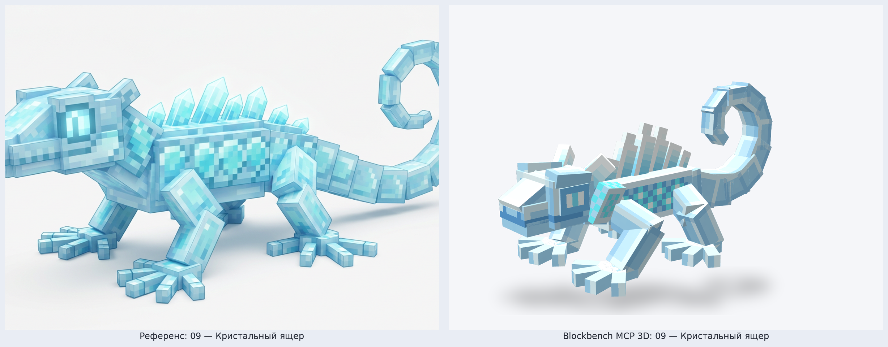
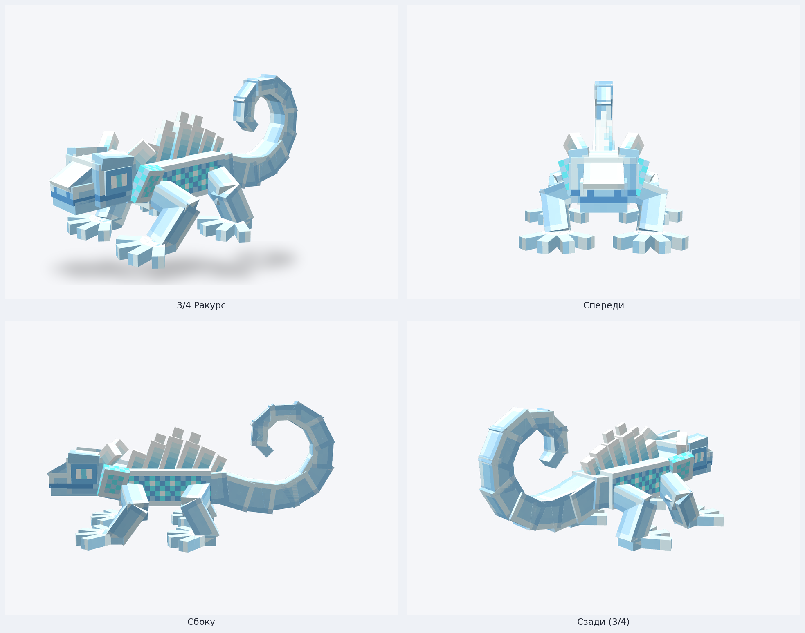

# Riftworld — Blockbench MCP 3D Models: Партия 3 (Модели 07–09)

Третья тройка детализированных шарнирных 3D-существ в стиле **Hytale / Blockbench**, собранная через официальный **Blockbench MCP** (`blockbench-mcp-plugin`, `.bbmodel` v5.0) и отрендеренная в студийном WebGL-вьюпорте Blockbench v5.2.2.

---

## Сводка валидации Blockbench MCP

| № | ID | Название | Биом | Иерархия костей | Элементов | Текстура | Geometry MCP | Animation MCP |
| :-: | :--- | :--- | :--- | :-: | :-: | :-: | :-: | :-: |
| **07** | `blossom_snail` | **Цветочная улитка** | `riftworld:waterfall_gardens` | 7 | 113 | `512×512` (32 px/block) | `0 errors, 0 warnings` | `0 errors, 0 warnings` |
| **08** | `phantom_wolf` | **Туманный волк-призрак** | `riftworld:mist_keep` | 9 | 70 | `512×512` (32 px/block) | `0 errors, 0 warnings` | `0 errors, 0 warnings` |
| **09** | `crystal_gecko` | **Кристальный ящер** | `riftworld:crystal_rifts` | 8 | 64 | `512×512` (32 px/block) | `0 errors, 0 warnings` | `0 errors, 0 warnings` |

Детальный JSON-отчёт автопроверок: [`validation_report.json`](./validation_report.json).

---

## 07 — Цветочная улитка (`blossom_snail`)

- **Биом:** `riftworld:waterfall_gardens` (Водопадные сады)
- **Геометрия и детали:** мягкая мятно-бирюзовая нога-подошва со светло-морской каймой и бирюзовыми крапинками, полосатая нежно-мятная грудка-шея, округлая голова с добродушной улыбкой, нижними щупиками и высокими глазными стебельками с белой склерой и вертикальными зрачками; массивная округлая розовая раковина, поросшая мхом и молодыми побегами, деревянистая чашечка-кайма и три концентрических спиральных венчика чашевидных лепестков сакуры вокруг сияющей золотисто-персиковой сердцевины с парящими пылинками пыльцы.
- **Файлы:**
  - Blockbench проект: [`blockbench/riftworld_fauna/blossom_snail.bbmodel`](../../../blockbench/riftworld_fauna/blossom_snail.bbmodel)
  - Bedrock Geometry / Animation: [`blossom_snail.geo.json`](../../../blockbench/riftworld_fauna/bedrock/blossom_snail.geo.json) · [`blossom_snail.animation.json`](../../../blockbench/riftworld_fauna/bedrock/blossom_snail.animation.json)
  - Riftworld Geo / Texture: [`blossom_snail.json`](../../../mod/src/main/resources/assets/riftworld/geo/blossom_snail.json) · [`blossom_snail.png`](../../../mod/src/main/resources/assets/riftworld/textures/entity/blossom_snail.png)

### Сравнение с концепт-референсом

### Ракурсы (3/4 · Спереди · Сбоку · Сзади 3/4)

---

## 08 — Туманный волк-призрак (`phantom_wolf`)

- **Биом:** `riftworld:mist_keep` (Туманная цитадель)
- **Геометрия и детали:** высокий поджарый спектральный волк в пепельно-туманной гамме на стройных лапах с поднимающимися струйками тумана, точёной волчьей мордой, пронзительно светящимися ледяными циановыми глазами, острыми стоячими ушами и завивающимися дымными прядями на скулах и загривке; полая скелетная грудная клетка с пятью парами рёбер, сквозь которые просвечивает пульсирующее бирюзово-циановое призрачное ядро, парящие частицы дымки и изогнутый многослойный шлейфовый хвост из клубов тумана.
- **Файлы:**
  - Blockbench проект: [`blockbench/riftworld_fauna/phantom_wolf.bbmodel`](../../../blockbench/riftworld_fauna/phantom_wolf.bbmodel)
  - Bedrock Geometry / Animation: [`phantom_wolf.geo.json`](../../../blockbench/riftworld_fauna/bedrock/phantom_wolf.geo.json) · [`phantom_wolf.animation.json`](../../../blockbench/riftworld_fauna/bedrock/phantom_wolf.animation.json)
  - Riftworld Geo / Texture: [`phantom_wolf.json`](../../../mod/src/main/resources/assets/riftworld/geo/phantom_wolf.json) · [`phantom_wolf.png`](../../../mod/src/main/resources/assets/riftworld/textures/entity/phantom_wolf.png)

### Сравнение с концепт-референсом

### Ракурсы (3/4 · Спереди · Сбоку · Сзади 3/4)

---

## 09 — Кристальный ящер (`crystal_gecko`)

- **Биом:** `riftworld:crystal_rifts` (Кристальные разломы)
- **Геометрия и детали:** приземистый распластанный ледяной ящер-геккон с гранёным черепом, светящейся переносицей, крупными утопленными циановыми глазами-фонарями с вертикальным зрачком, кристаллическими ушными рожками и шахматными ледяными воротниками на шее; ромбовидная светящаяся аква-чешуя на боках, гребень из шести наклонных заострённых кристаллов кварцевого льда на спине, четыре шарнирные лапы с четырьмя широко растопыренными кристаллическими пальцами на каждой ступне и 12-сегментный вертикально закрученный спиральный хвост.
- **Файлы:**
  - Blockbench проект: [`blockbench/riftworld_fauna/crystal_gecko.bbmodel`](../../../blockbench/riftworld_fauna/crystal_gecko.bbmodel)
  - Bedrock Geometry / Animation: [`crystal_gecko.geo.json`](../../../blockbench/riftworld_fauna/bedrock/crystal_gecko.geo.json) · [`crystal_gecko.animation.json`](../../../blockbench/riftworld_fauna/bedrock/crystal_gecko.animation.json)
  - Riftworld Geo / Texture: [`crystal_gecko.json`](../../../mod/src/main/resources/assets/riftworld/geo/crystal_gecko.json) · [`crystal_gecko.png`](../../../mod/src/main/resources/assets/riftworld/textures/entity/crystal_gecko.png)

### Сравнение с концепт-референсом

### Ракурсы (3/4 · Спереди · Сбоку · Сзади 3/4)

