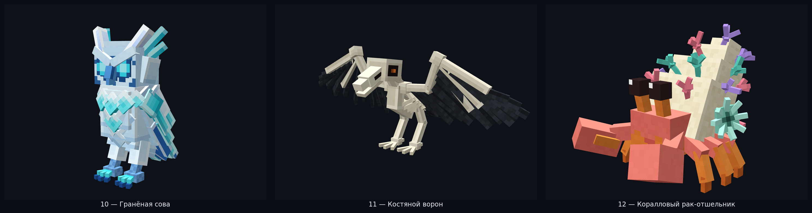
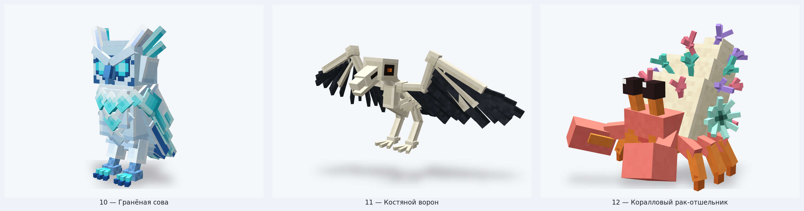
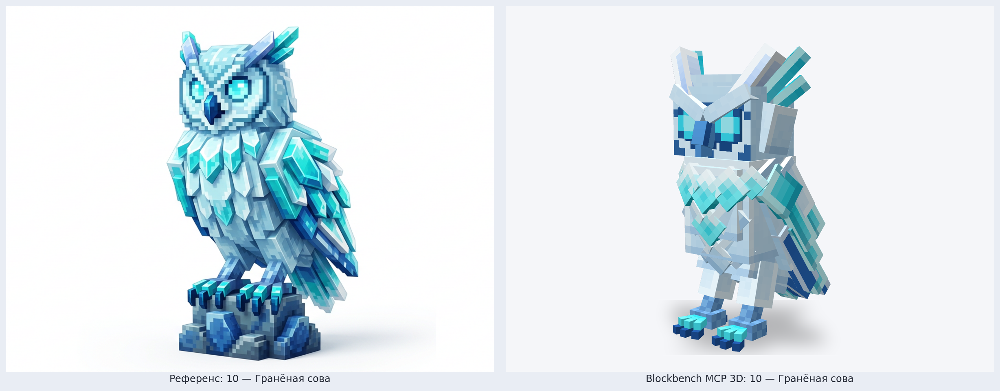
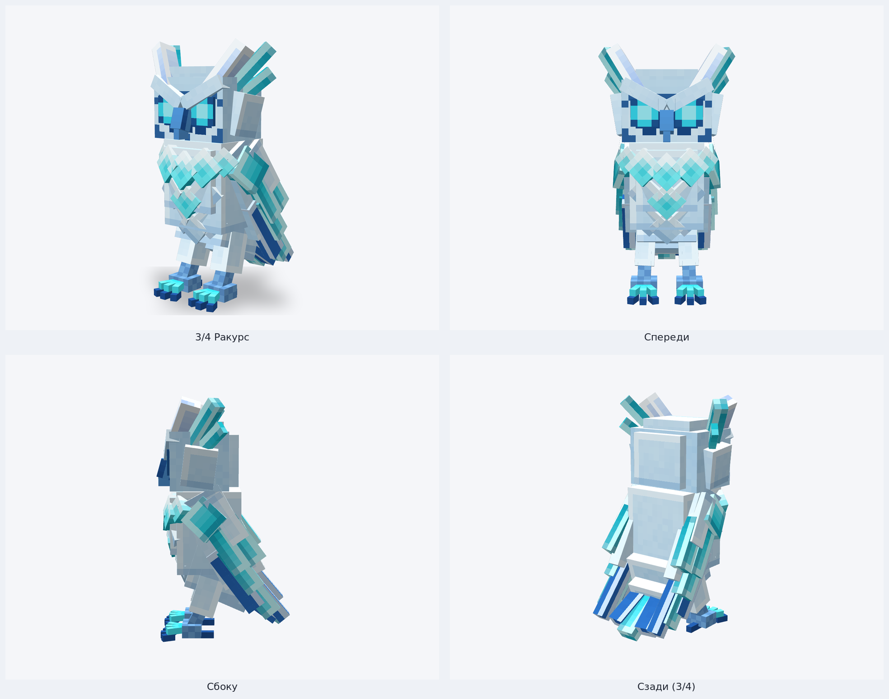
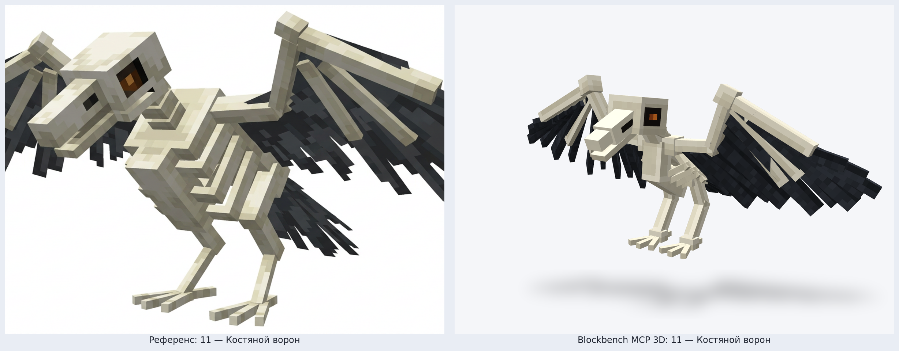
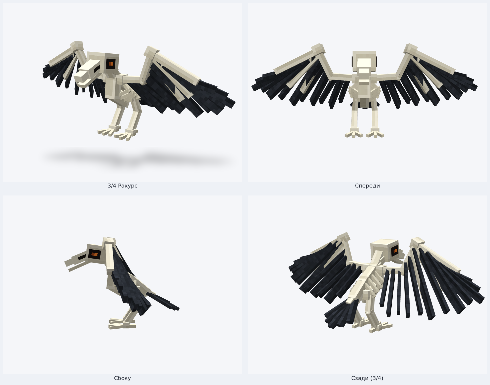
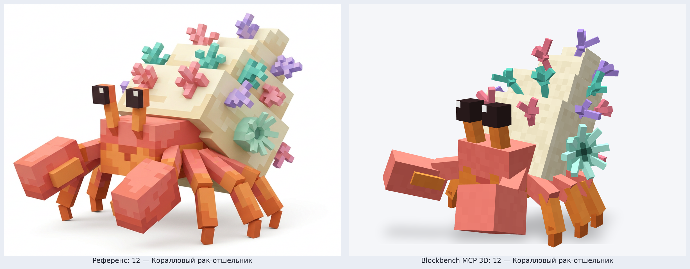
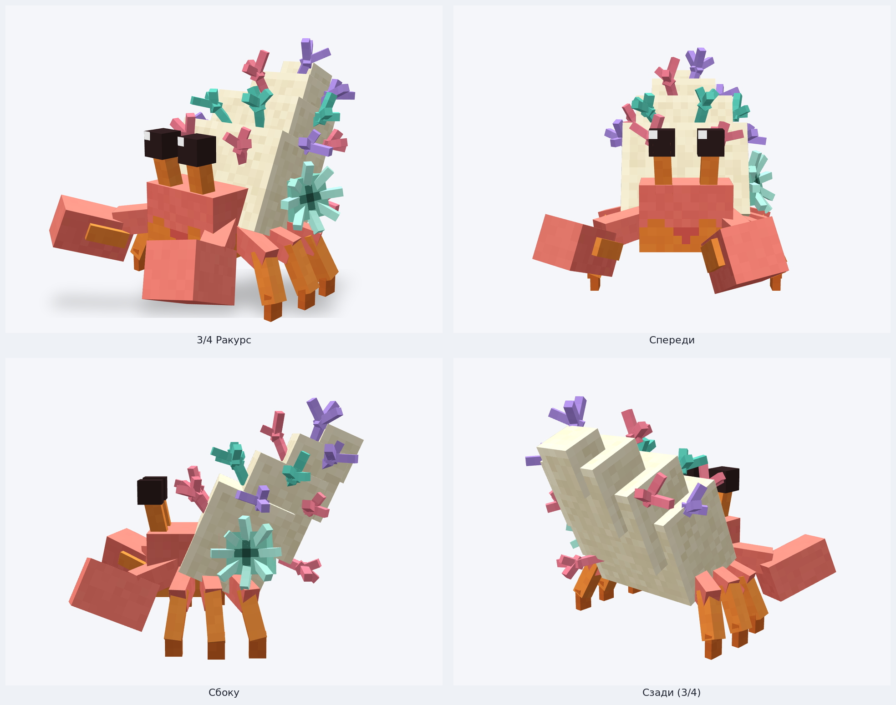

# Riftworld — Blockbench MCP 3D Models: Партия 4 (Модели 10–12)

Четвёртая тройка детализированных шарнирных 3D-существ в стиле **Hytale / Blockbench**, собранная через официальный **Blockbench MCP** (`blockbench-mcp-plugin`, `.bbmodel` v5.0) и отрендеренная в студийном WebGL-вьюпорте Blockbench v5.2.2.

---

## Сводка валидации Blockbench MCP

| № | ID | Название | Биом | Иерархия костей | Элементов | Текстура | Geometry MCP | Animation MCP |
| :-: | :--- | :--- | :--- | :-: | :-: | :-: | :-: | :-: |
| **10** | `faceted_owl` | **Гранёная сова** | `riftworld:crystal_rifts` | 8 | 73 | `512×512` (32 px/block) | `0 errors, 0 warnings` | `0 errors, 0 warnings` |
| **11** | `bone_raven` | **Костяной ворон** | `riftworld:morok_hollow` | 9 | 87 | `512×512` (32 px/block) | `0 errors, 0 warnings` | `0 errors, 0 warnings` |
| **12** | `coral_hermit_crab` | **Коралловый рак-отшельник** | `riftworld:shallow_reef` | 13 | 94 | `512×512` (32 px/block) | `0 errors, 0 warnings` | `0 errors, 0 warnings` |

Детальный JSON-отчёт автопроверок: [`validation_report.json`](./validation_report.json).

---

## 10 — Гранёная сова (`faceted_owl`)

- **Биом:** `riftworld:crystal_rifts` (Хрустальные разломы)
- **Геометрия и детали:** круглая совиная голова с парными лицевыми дисками, крупными светящимися бирюзово-циановыми глазами, крючковатым сапфирово-кобальтовым клювом, нахмуренными кристаллическими бровями и двойными гранёными ушками-перьями (перивинклово-ледяные внутренние и бирюзовые внешние); слоистое ожерелье из ромбовидных кристаллов на груди и брюшке, многоярусные кристаллические крылья с кобальтовыми маховыми пластинами, гранёный веер хвоста и когтистые лапы (кристаллическая подставка с концепта исключена).
- **Файлы:**
  - Blockbench проект: [`blockbench/riftworld_fauna/faceted_owl.bbmodel`](../../../blockbench/riftworld_fauna/faceted_owl.bbmodel)
  - Bedrock Geometry / Animation: [`faceted_owl.geo.json`](../../../blockbench/riftworld_fauna/bedrock/faceted_owl.geo.json) · [`faceted_owl.animation.json`](../../../blockbench/riftworld_fauna/bedrock/faceted_owl.animation.json)
  - Riftworld Geo / Texture: [`faceted_owl.json`](../../../mod/src/main/resources/assets/riftworld/geo/faceted_owl.json) · [`faceted_owl.png`](../../../mod/src/main/resources/assets/riftworld/textures/entity/faceted_owl.png)

### Сравнение с концепт-референсом

### Ракурсы (3/4 · Спереди · Сбоку · Сзади 3/4)

---

## 11 — Костяной ворон (`bone_raven`)

- **Биом:** `riftworld:morok_hollow` (Мороковая Падь)
- **Геометрия и детали:** выбеленный череп ворона с приоткрытым массивным клювом, продольными ноздревыми щелями и тлеющими оранжевыми угольками в глубоких чёрных глазницах; шейные позвонки с кольцами, полая скелетная грудная клетка с 4 парами изогнутых рёбер и выраженным птичьим килем, раскинутые угловатые костяные крылья с запястными суставами и тремя костяными пальцами поверх рваных угольно-чёрных маховых перьев, рваный чёрный хвост и костлявые четырёхпалые лапы.
- **Файлы:**
  - Blockbench проект: [`blockbench/riftworld_fauna/bone_raven.bbmodel`](../../../blockbench/riftworld_fauna/bone_raven.bbmodel)
  - Bedrock Geometry / Animation: [`bone_raven.geo.json`](../../../blockbench/riftworld_fauna/bedrock/bone_raven.geo.json) · [`bone_raven.animation.json`](../../../blockbench/riftworld_fauna/bedrock/bone_raven.animation.json)
  - Riftworld Geo / Texture: [`bone_raven.json`](../../../mod/src/main/resources/assets/riftworld/geo/bone_raven.json) · [`bone_raven.png`](../../../mod/src/main/resources/assets/riftworld/textures/entity/bone_raven.png)

### Сравнение с концепт-референсом

### Ракурсы (3/4 · Спереди · Сбоку · Сзади 3/4)

---

## 12 — Коралловый рак-отшельник (`coral_hermit_crab`)

- **Биом:** `riftworld:shallow_reef` (Мелководный риф)
- **Геометрия и детали:** кораллово-розовый с мандариново-оранжевым карапакс, высокие оранжевые глазные стебельки с квадратными тёмно-эспрессовыми глазами и однопиксельным белым бликом, гетерохельные (разноразмерные) клешни — крупная розовая давящая клешня и отставленная хватательная клешня с ярким оранжевым подвижным пальцем, 6 трёхсегментных ходильных лап; четырёхъярусная ступенчатая кремово-песчаная спиральная раковина, обросшая розовыми, мятно-бирюзовыми и лавандовыми ветвистыми кораллами и морской зелёной актинией с венчиком щупалец.
- **Файлы:**
  - Blockbench проект: [`blockbench/riftworld_fauna/coral_hermit_crab.bbmodel`](../../../blockbench/riftworld_fauna/coral_hermit_crab.bbmodel)
  - Bedrock Geometry / Animation: [`coral_hermit_crab.geo.json`](../../../blockbench/riftworld_fauna/bedrock/coral_hermit_crab.geo.json) · [`coral_hermit_crab.animation.json`](../../../blockbench/riftworld_fauna/bedrock/coral_hermit_crab.animation.json)
  - Riftworld Geo / Texture: [`coral_hermit_crab.json`](../../../mod/src/main/resources/assets/riftworld/geo/coral_hermit_crab.json) · [`coral_hermit_crab.png`](../../../mod/src/main/resources/assets/riftworld/textures/entity/coral_hermit_crab.png)

### Сравнение с концепт-референсом

### Ракурсы (3/4 · Спереди · Сбоку · Сзади 3/4)

