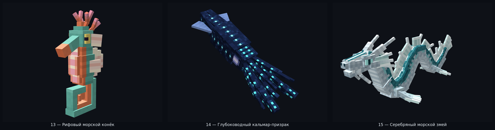
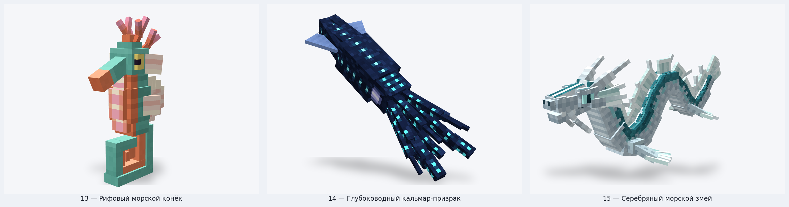
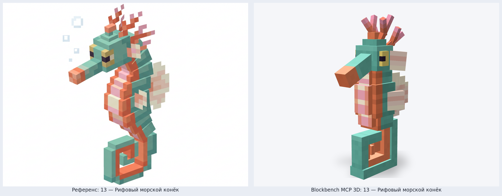
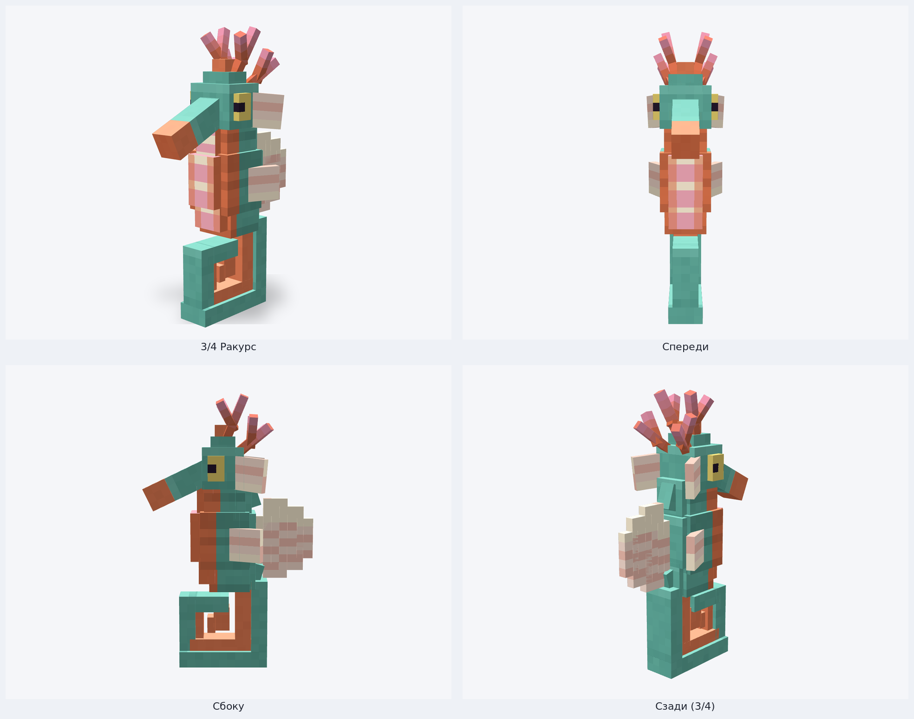
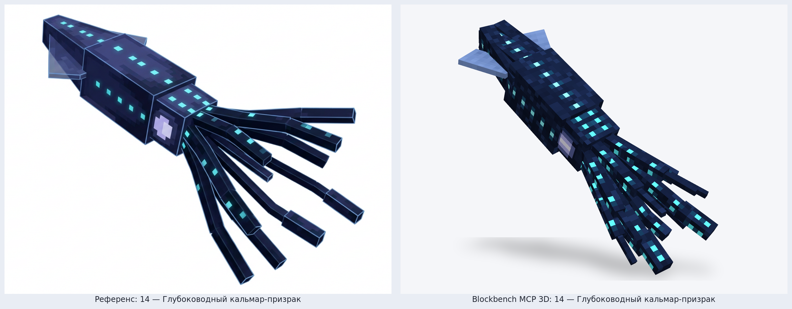
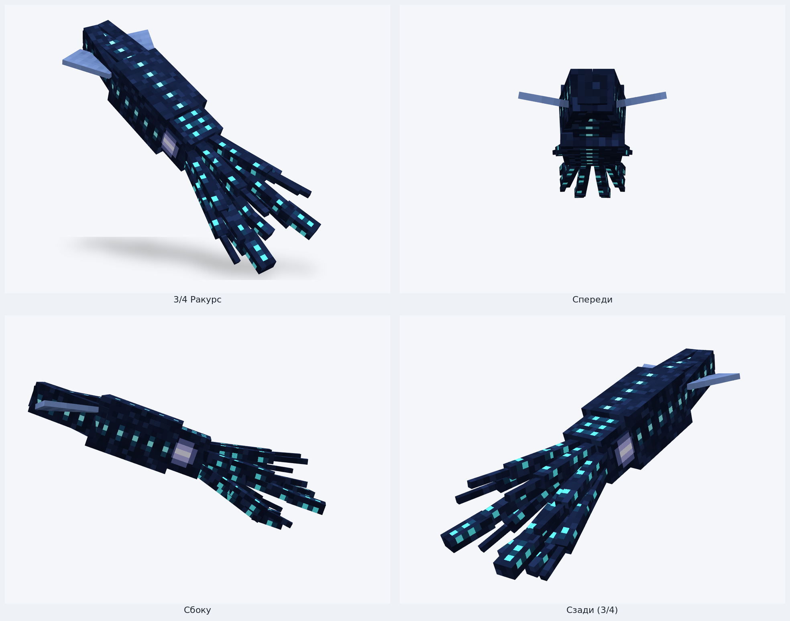
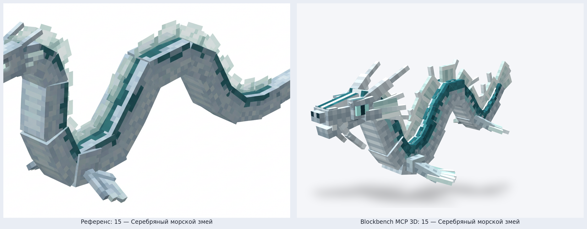
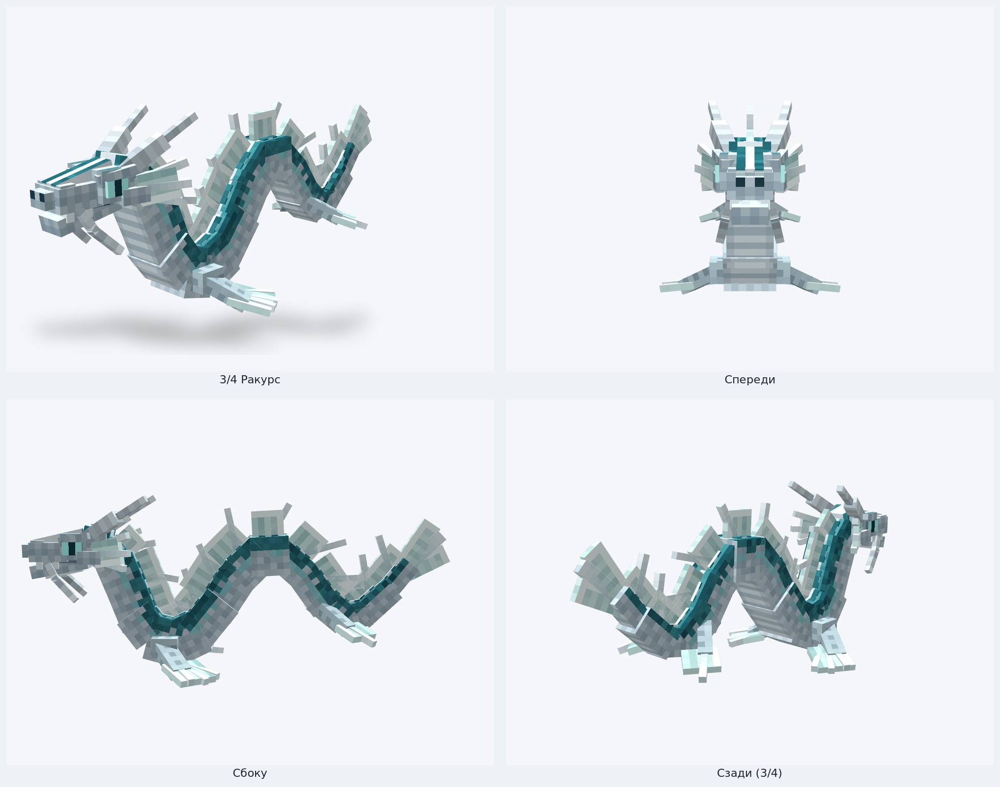

# Riftworld — Blockbench MCP 3D Models: Партия 5 (Модели 13–15, финальный выпуск)

Пятая, завершающая тройка детализированных шарнирных 3D-существ морских и глубоководных биомов в стиле **Hytale / Blockbench**, собранная через официальный **Blockbench MCP** (`blockbench-mcp-plugin`, `.bbmodel` v5.0) и отрендеренная в студийном WebGL-вьюпорте Blockbench v5.2.2. Вместе с Партиями 1–4 полностью завершает всю линейку из **15 существ (`01`–`15`)**.

---

## Сводка валидации Blockbench MCP

| № | ID | Название | Биом | Иерархия костей | Элементов | Текстура | Geometry MCP | Animation MCP |
| :-: | :--- | :--- | :--- | :-: | :-: | :-: | :-: | :-: |
| **13** | `reef_seahorse` | **Рифовый морской конёк** | `riftworld:shallow_reef` | 9 | 43 | `512×512` (32 px/block) | `0 errors, 0 warnings` | `0 errors, 0 warnings` |
| **14** | `ghost_squid` | **Глубоководный кальмар-призрак** | `riftworld:abyss` | 8 | 41 | `512×512` (32 px/block) | `0 errors, 0 warnings` | `0 errors, 0 warnings` |
| **15** | `silver_sea_serpent` | **Серебряный морской змей** | `riftworld:maja_ocean` | 11 | 120 | `512×512` (32 px/block) | `0 errors, 0 warnings` | `0 errors, 0 warnings` |

Детальный JSON-отчёт автопроверок: [`validation_report.json`](./validation_report.json).

---

## 13 — Рифовый морской конёк (`reef_seahorse`)

- **Биом:** `riftworld:shallow_reef` (Мелководный риф)
- **Геометрия и детали:** вертикальный силуэт с закрученным вперёд цепким спиральным хвостом (внешняя морская бирюзовая броня и тёплый кораллово-оранжевый внутренний завиток со сквозным окном спирали); трёхзонный корпус с чередующимися пастельно-розовыми и кремовыми сегментами брюшка, кораллово-оранжевыми боковыми килями и рельефными ступенчатыми бирюзовыми спинными щитками; многоярусный лучистый кремово-персиковый спинной веерный плавник, парные боковые и щёчные плавники; выступающие маслянисто-жёлтые башенные глаза с тёмно-сливовым горизонтальным зрачком, трубчатое рыльце с коралловым раструбом и ветвистые кораллово-розовые рожки-полипы на макушке (без посторонних частиц/пузырьков).
- **Файлы:**
  - Blockbench проект: [`blockbench/riftworld_fauna/reef_seahorse.bbmodel`](../../../blockbench/riftworld_fauna/reef_seahorse.bbmodel)
  - Bedrock Geometry / Animation: [`reef_seahorse.geo.json`](../../../blockbench/riftworld_fauna/bedrock/reef_seahorse.geo.json) · [`reef_seahorse.animation.json`](../../../blockbench/riftworld_fauna/bedrock/reef_seahorse.animation.json)
  - Riftworld Geo / Texture: [`reef_seahorse.json`](../../../mod/src/main/resources/assets/riftworld/geo/reef_seahorse.json) · [`reef_seahorse.png`](../../../mod/src/main/resources/assets/riftworld/textures/entity/reef_seahorse.png)

### Сравнение с концепт-референсом

### Ракурсы (3/4 · Спереди · Сбоку · Сзади 3/4)

---

## 14 — Глубоководный кальмар-призрак (`ghost_squid`)

- **Биом:** `riftworld:abyss` (Бездна)
- **Геометрия и детали:** диагональная стремительная поза реактивного плавания; четырёхгранный клиновидный торпедный купол мантии с полупрозрачными сизо-перламутровыми боковыми плавниками-стабилизаторами и основным прямоугольным отсеком мантии; бархатная полуночно-индиговая абиссальная кожа без контурных обводок с рядами биолюминесцентных циановых фотофоров и мягким ореолом свечения вдоль спины и боков; зауженный головной воротник с крупными светящимися бледно-лавандовыми глазами; 8 плавно изогнутых трёхсегментных рук и 2 удлинённых ловчих щупальца с булавовидными окончаниями и точками фотофоров.
- **Файлы:**
  - Blockbench проект: [`blockbench/riftworld_fauna/ghost_squid.bbmodel`](../../../blockbench/riftworld_fauna/ghost_squid.bbmodel)
  - Bedrock Geometry / Animation: [`ghost_squid.geo.json`](../../../blockbench/riftworld_fauna/bedrock/ghost_squid.geo.json) · [`ghost_squid.animation.json`](../../../blockbench/riftworld_fauna/bedrock/ghost_squid.animation.json)
  - Riftworld Geo / Texture: [`ghost_squid.json`](../../../mod/src/main/resources/assets/riftworld/geo/ghost_squid.json) · [`ghost_squid.png`](../../../mod/src/main/resources/assets/riftworld/textures/entity/ghost_squid.png)

### Сравнение с концепт-референсом

### Ракурсы (3/4 · Спереди · Сбоку · Сзади 3/4)

---

## 15 — Серебряный морской змей (`silver_sea_serpent`)

- **Биом:** `riftworld:maja_ocean` (Океан Майи)
- **Геометрия и детали:** детализированный морской дракон-левиафан (11 костей, 120 прямоугольных элементов) в плавном 16-сегментном мускулистом S-изгибе тела — скульптурный череп с носовым гребнем, нависающими надбровными дугами, светящимися циановыми глазами с вертикальным драконьим зрачком, шарнирной приоткрытой нижней челюстью с клыками, двухсегментными загнутыми рогами, трёхлучевыми жаберными веерами-плавниками и изогнутыми усиками; перепончатые трёхлучевые передние и задние ласты; накладные спинные броневые щитки, непрерывный переливающийся спинной парус с выступающими плавниковыми лучами, трёхлопастный хвостовой веер и перламутрово-серебряная чешуя с глубокой океанически-бирюзовой спинной полосой.
- **Файлы:**
  - Blockbench проект: [`blockbench/riftworld_fauna/silver_sea_serpent.bbmodel`](../../../blockbench/riftworld_fauna/silver_sea_serpent.bbmodel)
  - Bedrock Geometry / Animation: [`silver_sea_serpent.geo.json`](../../../blockbench/riftworld_fauna/bedrock/silver_sea_serpent.geo.json) · [`silver_sea_serpent.animation.json`](../../../blockbench/riftworld_fauna/bedrock/silver_sea_serpent.animation.json)
  - Riftworld Geo / Texture: [`silver_sea_serpent.json`](../../../mod/src/main/resources/assets/riftworld/geo/silver_sea_serpent.json) · [`silver_sea_serpent.png`](../../../mod/src/main/resources/assets/riftworld/textures/entity/silver_sea_serpent.png)

### Сравнение с концепт-референсом

### Ракурсы (3/4 · Спереди · Сбоку · Сзади 3/4)

