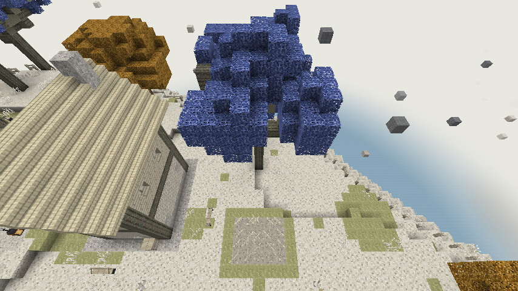
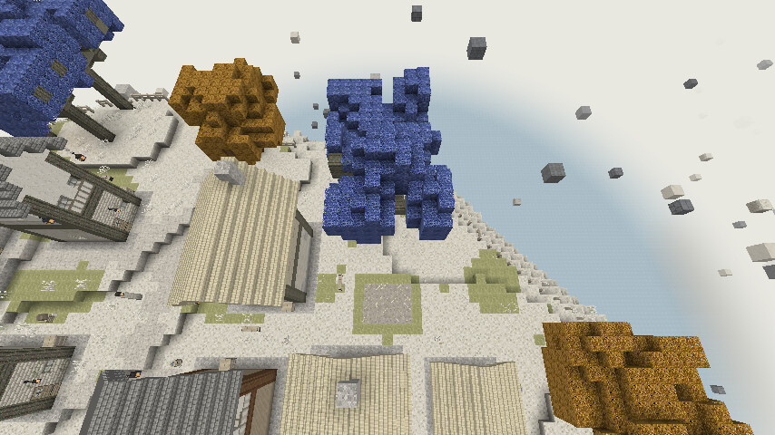
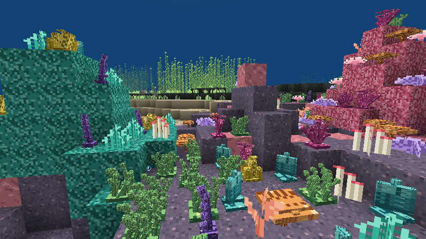
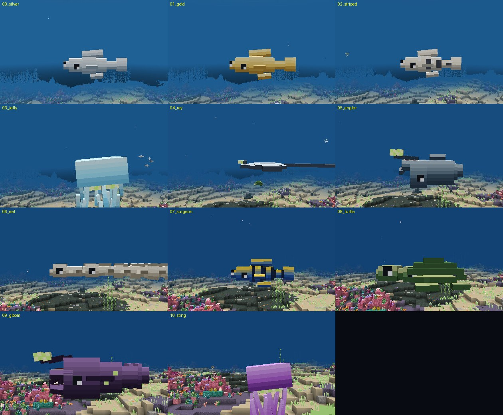
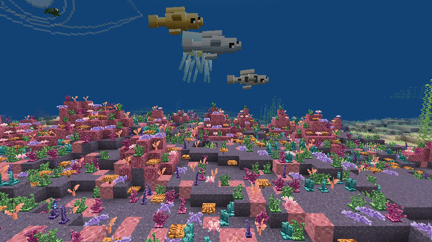
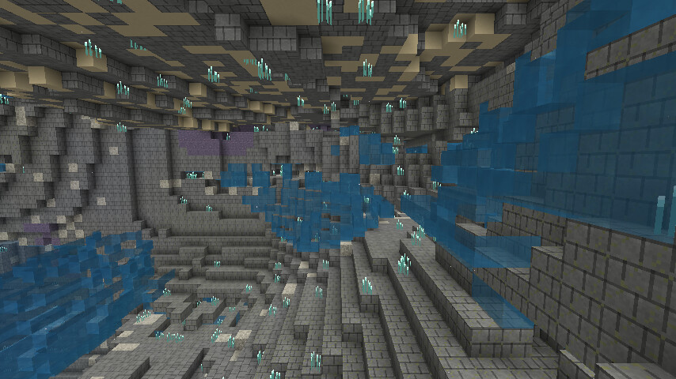

# Рев 11 — деревья, кораллы, рыбы, пещеры, аддон к Dynamic Trees

Что просил заказчик и что реально сделано. **Всё проверено живым клиентом Minecraft** (ForgeGradle
`runClient` под Xvfb + llvmpipe, без видеокарты) — кадры ниже сняты в CI, ни одна правка не
принималась «на глаз по коду».

- Релиз с двумя jar: **v0.9.0** (`riftworld-v0.9.0.jar`, `riftworld-dt-v0.9.0.jar`)
- Артефакты прогона (кадры, логи, пробы): ветка `ci-artifacts`, каталог `shots/`
- 14 из 14 живых проб — `OK`, строк `Exception/ERROR` в логе клиента — 0

---

## 1. Деревья: настоящие ветки вместо «сплошного квадрата»

Было: у сизо крона из колец вокруг ствола, у амбры — шар вокруг верхушки. Издалека читалось плитой.

Стало — **чертёж дерева** (`ElisarChunkGenerator.TileBlueprint`):

* ствол из брёвен по Y;
* **4–6 ветвей**, расходящихся вверх (каждая — цепочка брёвен по X/Z с шагом вверх), у каждой свой
  угол, длина и высота от seed дерева;
* **крона-облако** на конце КАЖДОЙ ветви плюс макушка — почти шар с рваным краем;
* ветки «прорезают» листву: сначала ставится листва, потом брёвна;
* чистка: листва, у которой меньше двух соседей (висела в воздухе после рваного контура),
  из чертежа выкидывается — в кроне больше нет одиночных кубиков;
* чертёж считается один раз и кешируется (`BLUEPRINTS`), генерация чанков не тормозит.

Текстуры (`tools/rift/gen_tree_textures.py`):

| Блок | Что | Как выглядит |
|---|---|---|
| `sizo_leaves` | сине-сиреневая листва, 4 тона | холодная сирень, читается на светлом грунте |
| `ambra_leaves` | янтарная листва, 4 тона | тёплая медь/янтарь |
| `sizo_log` / `ambra_log` | кора с бороздами и спилом-кольцами | появился объём, ствол больше не «серый столб» |

Листва больше **не тонируется цветом травы** (`ClientHooks.blockTints`) — иначе собственная
сирень/янтарь размывались в серо-зелёную кашу.

Проверка в игре — команда **`/rifttree [sizo|ambra]`**: находит ближайшее живое дерево нужного вида,
подгружает чанк, считает брёвна/ветви/листву в радиусе 12 **и отдаёт свободную точку обзора**
`cam=`/`camtop=` (дерево может стоять между домами — камера ищет направление, где нет стены).

Живой результат прогона:

```
rifttree at=-25,105,148 kind=sizo h=13 logs=111 branches=68 leaves=409 dist=14 loaded=true cam=-14,124,148 camtop=-14,134,148
OK   у дерева есть ветки: 68 блоков вне ствола
OK   дерево с ветками и кроной: ветвей 68, листвы 409
```

CI требует `branches >= 5` и `leaves >= 20`. Кадры: `14_tree_branches` (общий вид),
`14b_tree_top` (сверху, видно, как ветки выходят из кроны).




## 2. Кораллы: шесть НОВЫХ кастомных растений (старые не тронуты)

`tools/rift/gen_corals3d.py` генерирует 6 блоков с настоящей 3D-моделью из коробок (не плоский крестик):

| Блок | Что это | Элементов |
|---|---|---|
| `staghorn_coral` | оленьи рога: 7 веток по 4 сегмента с сужением к концу | 61 |
| `feather_coral` | перистый веер с пластинами | 11 |
| `sea_whip` | изогнутый хлыст с кисточками-полипами | 10 |
| `table_coral` | столовидный коралл в два яруса | 8 |
| `tube_sponge_cluster` | гроздь трубок разной высоты | 11 |
| `ribbon_coral` | спиральные ленты вокруг оси | 9 |

Всего 110 элементов, `bad rotations: 0`.

Технические грабли (обе выяснились на живых кадрах):

* **углы в блочных моделях Minecraft ограничены** набором −45 / −22.5 / 0 / 22.5 / 45; любые другие
  значения роняют загрузку модели («Invalid rotation … found») — скрипт округляет углы (`snap_angle`),
  а изгиб делается сегментами;
* у каждого коралла своя процедурная текстура 16×16 с четырьмя оттенками, поэтому коробки играют
  светом, а не выглядят пластиком.

Старые `coral_branch`, `coral_fan`, `coral_tube`, `coral_glow`, `anemone`, `coral_bush`, `tube_worms`
и все декали остались как были — новые просто добавлены в палитры кроны и ковёр между холмами.



## 3. Рыбы: мобы на JSON-моделях с текстурами

Было: 11 видов рисовались дебаг-квадами с белой текстурой — «поломанные, без текстур».

Стало:

* `tools/rift/gen_geo_fish.py` собирает для каждого вида **`assets/riftworld/geo/<вид>.json`** —
  скелет из костей (pivot, parent, rotation), коробки с UV и покадровую анимацию плавников/хвоста;
* **текстуры** `assets/riftworld/textures/entity/<вид>.png` рисуются по развёртке каждой коробки:
  градиент спина→брюхо, полосы/крапины по виду, глаза на голове, зубы в пасти, светящаяся приманка;
* `client/geo/GeoModel.java` грузит JSON, собирает ванильный `ModelPart`-скелет и анимирует кости;
* `client/SeaFishRenderer.java` рисует **все** кости (`getAllParts`) — иначе виден ровно один серый ящик;
* тела рыб — из трёх сегментов (одиночный `addBox` давал «куб» вместо рыбы).

Каждый вид переделан по своему живому кадру (не «все скопом»):

| Вид | Что было не так | Что сделано |
|---|---|---|
| `silver`, `gold`, `striped`, `surgeon` | тело-куб | три сегмента с сужением к хвосту, спинной/брюшной плавники, грудные плавники на шарнирах |
| `jelly` | щупальца росли ВВЕРХ из купола («свечки на кубе») | купол + 5 щупалец и 4 ротовые лопасти вниз |
| `ray` | плоский «утюг» | диск с утолщением, ступенчатые крылья в два пера, хлыст-хвост, глаза сверху |
| `angler` | приманка торчала назад, пасть внутри головы | пасть вынесена вперёд, нижняя челюсть на шарнире, приманка на стебле над головой |
| `eel` | все сегменты в одной точке → кирпич | пять сегментов цепочкой по Z, голова с пастью впереди, спинная складка |
| `turtle` | голова и ласты ВНУТРИ панциря → плита | купол из трёх ступеней, шея и голова вперёд, четыре ласта и хвост |
| `gloom` | пасть внутри головы, зубы торчали из боков | узкое тело с сужением, верхняя и нижняя челюсти впереди, биолюминесцентные точки |
| `sting` | как у `jelly` — щупальца вверх | шесть длинных щупалец вниз от купола |

Отдельная находка: **в клиенте ось +Y смотрит вверх**, а в координатах коробок JSON «низ» — это +Y.
Из-за этого плавники и щупальца сначала оказались вывернутыми; соглашение зафиксировано в коде
и в оффлайн-превью.

Чтобы не гонять 20-минутный CI ради каждой правки формы, добавлен
**`tools/rift/preview_geo.py`** — ортографический рендер тех же JSON и текстур на Python (секунды),
с флагом `--axis` (маркеры верха/низа). Все правки выше проверены сначала им, потом живым клиентом.

Лог клиента: `geo jelly: 10 костей/11 деталей`, `ray 5/6`, `turtle 7/12`, `eel 7/12`,
`silver/gold/striped/surgeon 6/10`, `gloom 7/22`, `angler 5/12`, `sting 7/8`; ошибок загрузки — 0.
CI снимает **каждый вид отдельным кадром** (`model_00_silver` … `model_10_sting`), рыба стоит к камере
боком (`Rotation:[90f,0f]`), поэтому виден профиль, плавники и хвост.




## 4. Пещеры: вода по направлению хода, а не «на рандом»

Было: воздух в полостях ставился одним 3D-шумом — заполнение случайное.

Стало (`ElisarSea.dryPocket`) — решает геометрия хода:

| Направление хода | Что с водой |
|---|---|
| уходит **вниз** | залит полностью: воздуху неоткуда взяться |
| **горизонтальный** | вода стоит, у сводов иногда остаются карманы (неполный залив) |
| уходит **вверх и тупиковый** | воздушная пробка: вода туда не поднимется |
| уходит **вверх, но сверху открытая вода** | залит доверху |
| «синяя дыра» (колодец в дне) | всегда полный залив |

Замер в живом мире: полостей **8592** колонок, воды **171 987** блоков, воздуха **46 020** — то есть
**78% / 22%** (симулятор `tools/rift/sim_sea.py` даёт 77.3 / 22.7). Воздух теперь только в карманах,
провалов «дыра в пустоту» нет.



## 5. Баг: пустота под адскими угодьями — исправлен

Причина: `AshenLands.column` заполнял только блоки от `ocean-2` и выше, всё ниже оставалось воздухом;
на стыках с морем колонки вообще не заполнялись. Отсюда «под замком нет ни моря, ни чего, можно упасть».

Исправление (`ElisarChunkGenerator.bedrockFloor`):

* **две плиты бедрока** на самом низу мира в КАЖДОЙ колонке (и в `getBaseColumn`);
* под пепельной равниной — **монолит** из обожжённого камня с прожилками от бедрока до подошвы равнины.

Теперь под адскими угодьями физически некуда провалиться.

## 6. Аддон к Dynamic Trees (`riftworlddt`) — собирается и лежит в релизе

Отдельный мод-jar **`riftworld-dt-0.9.0.jar`**, собирается тем же gradle: `./gradlew jar dtJar`
(в CI — отдельный workflow «Build jars (mod + Dynamic Trees addon)», оба jar кладутся в релиз).

Состав (всё — данные, Java только точка входа):

```
trees/riftworlddt/
  families/sizo.json, ambra.json          семейства: ветка + листва + примитивное бревно
  species/sizo.json, ambra.json, giant_sizo.json
  leaves_properties/*.json                наши листья как primitive_leaves
  soil_properties/elisar_grass.json, elisar_soil.json
  jo_codes/*.txt                          формы крон (формат Dynamic Trees)
  world_gen/elisar.json                   где растут: sizo_grove, violet_hills, waterfall_gardens, elisar_city
data/riftworlddt/forge/biome_modifier/elisar_trees.json
```

Dynamic Trees сам сканирует папку `trees/` у всех модов, поэтому аддон не привязан к версии API.
Для живой проверки: `./gradlew runClient -PwithDT` (тянет `DynamicTrees-1.20.1` с публичного maven
`harleyoconnor.com/maven`); в обычной сборке зависимость не подключается.

По ходу починена реальная поломка: `processDtaddonResources` падал на `duplicate entry META-INF/mods.toml`
(ForgeGradle подмешивает mods.toml в каждый sourceSet) — аддон-jar вообще не собирался, а ошибка
маскировалась конвейером `| tee` в CI. Теперь: дубликат отфильтрован, в шаге сборки включён `pipefail`.

## 7. Референсы здания с порталом (по ТЗ — только референсы)

`reports/portal_hall/`:

* `ref_abandoned_overworld.png` — заброшенный вариант для обычного мира (трещины, вода, мох, обрушенный купол);
* `ref_pristine_elisar.png` — целый вариант для Элисара (белый камень, золото, бирюзовая глазурь, портал-кольцо);
* `README.md` — разбор: сетка постройки, материалы, палитры, что где стоит.

Само здание по ТЗ не строится.

## 8. Как это проверялось

`.github/workflows/sea-check.yml`, три шага:

1. **Build mod jar** — `./gradlew jar dtJar` (теперь с `pipefail`, падение не маскируется);
2. **Boot Forge server** — реальный сервер Forge 1.20.1-47.4.23, `Done`, 0 Exception/ERROR;
3. **Launch real Minecraft client** — ForgeGradle `runClient` под Xvfb (llvmpipe), вход в мир,
   `/execute in riftworld:elisar`, RCON-пробы и скриншоты (`shots/*.jpg`).

Кадры и `probes.txt` коммитятся в ветку `ci-artifacts`; артефакты GitHub из этой среды не скачиваются
(EOF от blob storage), поэтому лог сборки аддона дополнительно кладётся в ветку `dt-artifacts`.

## 9. Что осталось / ограничения

* Живая проверка с самим Dynamic Trees (`-PwithDT`) в CI выключена по умолчанию (`WITH_DT=1` включает):
  `dt setTree` по RCON не срабатывает надёжно, поэтому проверяется только то, что аддон виден моду
  (`give riftworlddt:sizo_seed`) — сами деревья DT вживую ещё не сняты.
* Кадры в CI — 854×480 (llvmpipe, окно маленькое): для оценки формы хватает, для «обложки» — нет.
